---
puppeteer:
    pdf:
        format: A4
        displayHeaderFooter: true
        landscape: false
        scale: 0.8
        margin:
            top: 1.2cm
            right: 1cm
            bottom: 1cm
            left: 1cm
    image:
        quality: 100
        fullPage: false
---

OpenDID IssuerAdmin Operation Guide
==

- Date: 2026-10-21
- Version: v2.0.1

개정 이력
==
| 버전   | 일자       | 변경 내용                  |
| ------ | ---------- | -------------------------- |
| v1.0.0 | 2025-03-31 | 최초 작성                  |
| v1.0.1 | 2025-04-25 | `3.1. Issuer Registration` 장 추가 <br> `3.5. Issued VC Management` 장 수정 |
| v2.0.0 | 2025-05-29 |  `3.4. ZKP Management` 장 추가 |
| v2.0.0 | 2026-06-19 | OID4VCI, Server Configuration, Password Policy 절 추가 |
| v2.0.1 | 2026-10-21 | 사이드 메뉴 개편(OID4VCI / OpenDID / Issued Credentials)에 맞춰 3장 재구성 <br> `3.7.1. OID4VCI Credentials`(발급 이력 조회·상태 변경) 추가 <br> Issuance Profile의 Issuance Mode, User Query Method 설명 추가 <br> Issuer Metadata의 Credential Revocation Endpoint 추가 <br> 최초 로그인 시 ID·비밀번호 변경 절차 반영 및 전체 화면 이미지 갱신 |

목차
==
- [OpenDID IssuerAdmin Operation Guide](#opendid-issueradmin-operation-guide)
- [개정 이력](#개정-이력)
- [목차](#목차)
- [1. 소개](#1-소개)
  - [1.1. 개요](#11-개요)
  - [1.2. Admin Console 정의](#12-admin-console-정의)
- [2. 기본 메뉴얼](#2-기본-메뉴얼)
  - [2.1. 로그인](#21-로그인)
  - [2.2. 메인 화면 구성](#22-메인-화면-구성)
  - [2.3. 메뉴 구성](#23-메뉴-구성)
    - [2.3.1. Issuer 미등록 상태](#231-issuer-미등록-상태)
    - [2.3.2. Issuer 등록 상태](#232-issuer-등록-상태)
  - [2.4. 비밀번호 변경 관리](#24-비밀번호-변경-관리)
- [3. 기능별 상세 메뉴얼](#3-기능별-상세-메뉴얼)
  - [3.1. Issuer Registration](#31-issuer-registration)
  - [3.2. Issuer Management](#32-issuer-management)
  - [3.3. OID4VCI](#33-oid4vci)
    - [3.3.1. Issuer Metadata](#331-issuer-metadata)
    - [3.3.2. Credential Configurations](#332-credential-configurations)
    - [3.3.3. Client Settings](#333-client-settings)
    - [3.3.4. List Provider](#334-list-provider)
  - [3.4. OpenDID - VC](#34-opendid---vc)
    - [3.4.1. Namespaces](#341-namespaces)
    - [3.4.2. VC Schemas](#342-vc-schemas)
    - [3.4.3. Issuance Profiles](#343-issuance-profiles)
  - [3.5. OpenDID - ZKP](#35-opendid---zkp)
    - [3.5.1. Namespaces](#351-namespaces)
    - [3.5.2. Credential Schemas](#352-credential-schemas)
    - [3.5.3. Credential Definitions](#353-credential-definitions)
  - [3.6. User Management](#36-user-management)
  - [3.7. Issued Credentials](#37-issued-credentials)
    - [3.7.1. OID4VCI Credentials](#371-oid4vci-credentials)
    - [3.7.2. OpenDID Credentials](#372-opendid-credentials)
  - [3.8. Server Configuration](#38-server-configuration)
  - [3.9. Admin Management](#39-admin-management)
    - [3.9.1. Admin Management](#391-admin-management)
    - [3.9.2. Password Policy Settings](#392-password-policy-settings)

---

# 1. 소개

## 1.1. 개요

본 문서는 Open DID Issuer Admin Console의 설치 및 구동 방법을 안내합니다.
기본 사용법부터 각 기능별 상세 매뉴얼까지 단계적으로 설명하여, 사용자가 콘솔을 효율적으로 활용할 수 있도록 구성되어 있습니다.

OpenDID의 전체 설치에 대한 가이드는 [Open DID Installation Guide]를 참고해 주세요.

## 1.2. Admin Console 정의

**Issuer Admin Console**은 Open DID 시스템 내에서 **Issuer 서버**를 관리하기 위한 웹 기반의 관리자 도구입니다.

Issuer는 Verifiable Credential(VC)의 발급 주체로서, VC 발급과 관련된 네임스페이스, 스키마, 발급 정책(프로파일) 등의 관리 기능을 제공합니다. 또한 OID4VCI(OpenID for Verifiable Credential Issuance) 프로토콜로 SD-JWT VC와 mdoc을 발급하기 위한 설정을 함께 관리합니다.

Issuer Admin Console에서 설정할 수 있는 주요 항목은 다음과 같습니다:

- **Issuer 기본 정보 관리**
  - Issuer 서버 등록 및 상태 확인
- **OID4VCI 발급 설정**
  - Issuer Metadata(Endpoint, 암호화 지원 정보) 관리
  - Credential Configuration 등록 및 관리
  - OID4VCI Client 설정 및 List Provider 등록
- **OpenDID VC 발급 항목 관리**
  - Namespace 등록 및 항목 구성
  - VC Schema 등록 및 관리
  - 발급 정책(Issuance Profile) 설정
- **OpenDID ZKP 발급 항목 관리**
  - Namespace 등록 및 항목 구성
  - Credential Schema 등록
  - Credential Definition 등록
- **사용자 및 발급 이력 관리**
  - 발급 대상 사용자 관리
  - OID4VCI / OpenDID로 발급된 Credential 목록 확인 및 상태 관리
- **서버 및 관리자 설정**
  - 외부 서버 연동 API Key 설정
  - 관리자 계정 및 비밀번호 정책 관리

# 2. 기본 메뉴얼

이 장에서는 Open DID Issuer Admin Console의 기본적인 사용 방법에 대해 안내합니다.

## 2.1. 로그인

Issuer Admin Console에 접속하려면 다음 단계를 따르세요:

1. 웹 브라우저를 열고 Issuer Admin Console URL에 접속합니다.

   ```
   http://<issuer_domain>:<port>
   ```

2. 로그인 화면에서 관리자 계정의 이메일과 비밀번호를 입력합니다.
   - 기본 관리자 계정: <admin@opendid.omnione.net>
   - 초기 비밀번호: password

3. 'SIGN IN' 버튼을 클릭합니다.

로그인 결과에 따라 다음 절차가 추가로 진행됩니다.

| 상황 | 동작 |
| ---- | ---- |
| ROOT 계정 최초 로그인 | **ID·비밀번호 변경** 다이얼로그가 표시됩니다. 기본 계정 ID와 초기 비밀번호를 새 값으로 변경해야 콘솔에 진입할 수 있으며, 변경 후 새 ID로 자동 로그인됩니다. |
| 비밀번호 재설정이 필요한 경우 | 새로 등록된 관리자 계정의 최초 로그인, 비밀번호 만료, ROOT 관리자에 의한 비밀번호 변경 이후에는 **비밀번호 재설정** 다이얼로그가 표시됩니다. 새 비밀번호를 저장하면 자동으로 로그인됩니다. |
| 그 외 | Issuer 등록 상태에 따라 `Issuer Registration` 또는 `Issuer Management` 화면으로 이동합니다. |

> **참고**:  
> 보안상의 이유로 최초 로그인 시 기본 계정 정보(ID, 비밀번호)를 반드시 변경해야 합니다.  
> 비밀번호 규칙과 만료 기간은 [3.9.2. Password Policy Settings](#392-password-policy-settings)에서 설정합니다.

<br/>


## 2.2. 메인 화면 구성

로그인 후 표시되는 메인 화면은 다음과 같은 요소들로 구성되어 있습니다:


| 번호 | 영역             | 설명                                                                                                                                |
| ---- | ---------------- | ----------------------------------------------------------------------------------------------------------------------------------- |
| 1    | 헤더 영역        | 좌측 상단의 `SETTING` 버튼을 통해 비밀번호 변경 화면으로 이동할 수 있습니다.                                                        |
| 2    | 콘텐츠 영역      | 현재 선택된 메뉴의 제목과 해당 콘텐츠가 표시됩니다. 각 메뉴에 따라 화면 내용이 바뀝니다.                                            |
| 3    | 사이드 메뉴      | 화면 왼쪽에 위치하며, 주요 메뉴 항목들이 세로로 정렬되어 있습니다. 선택한 메뉴는 강조 표시되며, 필요한 경우 하위 메뉴가 펼쳐집니다. |
| 4    | 사용자 정보 영역 | 현재 로그인한 관리자의 이메일 주소와 '로그아웃(Sign Out)' 버튼이 표시됩니다.                                                        |

> **참고**: 목록 화면에는 공통으로 검색 조건 선택, 검색어 입력, `SEARCH` 버튼과 목록을 다시 조회하는 새로고침 버튼이 제공됩니다.

<br/>

## 2.3. 메뉴 구성

Issuer Admin Console의 사이드바 메뉴는 **Issuer 등록 상태에 따라 화면 구성에 차이**가 있습니다.


<br/>

### 2.3.1. Issuer 미등록 상태

Issuer 서버가 아직 등록되지 않은 초기 상태에서는
메뉴에 Issuer Registration 항목만 단독으로 표시됩니다.

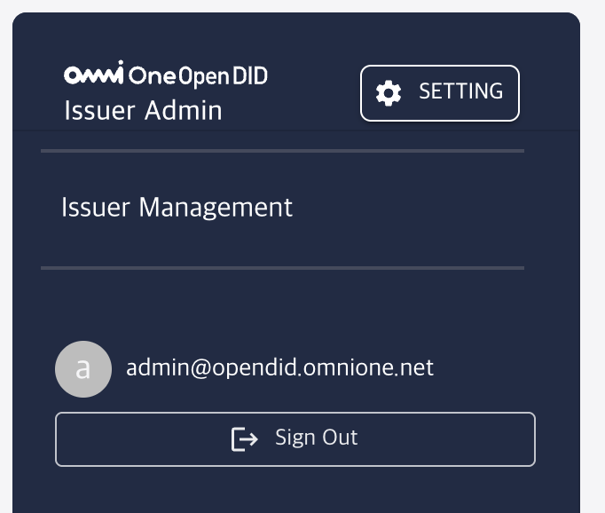

> 참고: Issuer 등록이 완료되면 관련 기능들이 활성화되며, 전체 메뉴가 확장됩니다.
등록 이후 메뉴 구성에 대한 자세한 내용은 추후 항목에서 설명합니다.

### 2.3.2. Issuer 등록 상태

Issuer 등록이 완료되면 전체 관리 기능이 활성화되며, 사이드바 메뉴는 프로토콜(OID4VCI / OpenDID)과 관리 목적을 기준으로 다음과 같이 구성됩니다:

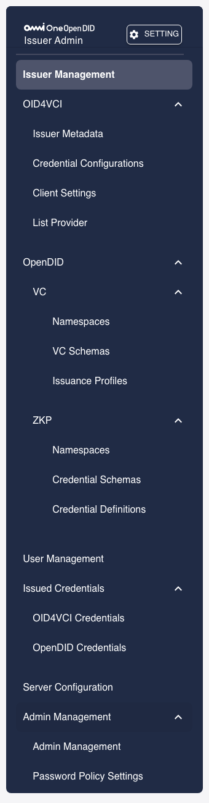

| 번호 | 메뉴 명칭 | Depth | 설명 |
|------|-----------|--------|------|
| 1 | **Issuer Management** | 1 | Issuer 서버의 기본 정보(DID, 상태 등)를 확인하고 관리하는 메뉴입니다. |
| 2 | **OID4VCI** | 1 | OID4VCI 발급 설정을 관리하는 상위 메뉴입니다. |
| 3 | └ Issuer Metadata | 2 | 공개 Issuer Metadata의 Endpoint와 암호화 지원 정보를 관리합니다. |
| 4 | └ Credential Configurations | 2 | OID4VCI로 발급할 Credential Configuration을 관리합니다. |
| 5 | └ Client Settings | 2 | OID4VCI 발급에 사용하는 공통 및 Platform별 Client 설정을 관리합니다. |
| 6 | └ List Provider | 2 | 사용자 주도 Webview 발급을 위해 List Provider에 Issuer 등록을 요청합니다. |
| 7 | **OpenDID** | 1 | OpenDID 프로토콜 VC/ZKP 발급 항목을 설정하는 상위 메뉴입니다. |
| 8 | └ VC | 2 | 일반 VC 발급 항목 메뉴 그룹입니다. |
| 9 | &nbsp;&nbsp;&nbsp;└ Namespaces | 3 | VC 발급에 사용되는 Namespace를 등록하고 관리합니다. |
| 10 | &nbsp;&nbsp;&nbsp;└ VC Schemas | 3 | VC 발급에 사용될 VC Schema를 등록하고 관리합니다. |
| 11 | &nbsp;&nbsp;&nbsp;└ Issuance Profiles | 3 | VC 발급 시 필요한 발급 프로파일을 관리합니다. |
| 12 | └ ZKP | 2 | ZKP 발급 항목 메뉴 그룹입니다. |
| 13 | &nbsp;&nbsp;&nbsp;└ Namespaces | 3 | Credential Schema에 사용되는 ZKP Namespace를 등록하고 관리합니다. |
| 14 | &nbsp;&nbsp;&nbsp;└ Credential Schemas | 3 | Credential Definition에 사용될 Credential Schema를 등록하고 관리합니다. |
| 15 | &nbsp;&nbsp;&nbsp;└ Credential Definitions | 3 | ZKP Credential 발급에 사용될 Credential Definition을 등록하고 관리합니다. |
| 16 | **User Management** | 1 | VC를 발급받을 사용자 정보를 관리하는 메뉴입니다. |
| 17 | **Issued Credentials** | 1 | 발급된 Credential을 프로토콜별로 조회하는 상위 메뉴입니다. |
| 18 | └ OID4VCI Credentials | 2 | OID4VCI로 발급된 Credential 이력을 조회하고 상태를 변경합니다. |
| 19 | └ OpenDID Credentials | 2 | OpenDID 프로토콜로 발급된 VC 목록을 조회하고 상태를 변경합니다. |
| 20 | **Server Configuration** | 1 | 외부 서버 연동에 필요한 API Key를 설정합니다. |
| 21 | **Admin Management** | 1 | 관리자 계정과 비밀번호 정책을 관리하는 상위 메뉴입니다. |
| 22 | └ Admin Management | 2 | 관리자 계정을 조회·등록·삭제합니다. |
| 23 | └ Password Policy Settings | 2 | 관리자 비밀번호 규칙과 만료 기간을 설정합니다. |

> **참고**:  
> 목록 화면은 새 메뉴 경로(`/opendid/vc/...`, `/opendid/zkp/...`, `/issued-credentials/...`)를 사용하며, 등록·상세·수정 화면은 기존 경로(`/vc-management/...`, `/zkp-management/...`)를 그대로 사용합니다.  
> 위 메뉴 구성에 대한 각 기능의 상세 사용법은 [3장. 기능별 상세 메뉴얼](#3-기능별-상세-메뉴얼)에서 메뉴 순서에 따라 설명합니다.
<br/>

## 2.4. 비밀번호 변경 관리

사용자 비밀번호 변경은 다음 단계를 통해 수행할 수 있습니다:

1. 헤더 영역의 'SETTING' 버튼을 클릭합니다.
2. 설정 메뉴에서 '비밀번호 변경'을 선택합니다.
3. 비밀번호 변경 화면에서:
   - 현재 비밀번호 입력
   - 새 비밀번호 입력
   - 새 비밀번호 확인 입력
4. '저장' 버튼을 클릭하여 변경 사항을 적용합니다.

> **참고**: 비밀번호는 [3.9.2. Password Policy Settings](#392-password-policy-settings)에 설정된 길이와 문자 구성 규칙(대문자, 숫자, 특수문자)을 만족해야 합니다.

<br/>

# 3. 기능별 상세 메뉴얼

이 장에서는 Issuer Admin Console의 주요 기능에 대한 상세 사용 방법을 사이드 메뉴 순서대로 안내합니다.

> **중요 안내**
> Issuer Admin Console의 주요 기능(VC 발급 관련 설정 포함)은 **Issuer Registration**을 먼저 완료한 경우에만 사용할 수 있습니다.
> Issuer 등록이 완료되어야 시스템 내 모든 VC 관련 관리 메뉴가 활성화되며, 발급 대상 VC 구성 또한 설정할 수 있습니다.

또한, VC를 실제로 발급하기 위해서는 다음의 절차를 선행적으로 수행해야 합니다.

* **OID4VCI 발급을 위한 기본 구성 절차**

  1. **Issuer Metadata 확인** – Credential Issuer URL, Authorization Server 및 Endpoint 확인
  2. **Credential Configuration 등록** – 발급할 Credential의 Format, Identifier, Metadata 정의
  3. **Client Settings 확인** – Wallet 및 Authorization Client 설정
  4. **(사용자 주도 Webview 발급 시) List Provider 등록 요청**

* **OpenDID VC 발급을 위한 기본 구성 절차**
  
  1. **Namespace 등록** – VC에 포함될 Claim 항목 정의
  2. **VC Schema 등록** – Namespace 기반 VC 데이터 구조 정의
  3. **Issuance Profile 등록** – 발급 방식 및 정책을 구성하는 발급 프로파일 등록

* **ZKP 기반 VC 발급을 위한 추가 구성 절차**

  1. **ZKP Namespace 등록** – ZKP 방식에 특화된 Claim 구성
  2. **Credential Schema 등록** – ZKP 방식에 맞춘 VC 스키마 정의
  3. **Credential Definition 등록** – ZKP 네트워크와 연결된 Definition 정의
  4. **Issuance Profile 등록 시 ZKP 설정 포함** – 해당 Definition ID를 기반으로 ZKP 발급 활성화

위 설정이 완료된 이후에야 사용자 등록 및 VC 발급이 가능하며, 잘못된 순서로 접근할 경우 VC 발급 실패나 UI 비활성 등의 오류가 발생할 수 있습니다.

> **참고**
> 모든 VC 관련 구성은 **Issuer 등록 이후** 진행할 수 있으며, 시스템은 선행 항목의 존재 여부를 기준으로 화면 내 선택 항목 또는 버튼을 제한하거나 오류 메시지를 표시합니다.


## 3.1. Issuer Registration

Issuer Registration은 Issuer Admin Console을 통해 발급 주체인 Issuer를 등록하기 위한 절차입니다. 전체 등록은 총 3단계로 구성되며, 각 단계별로 입력, 요청, 승인 과정을 거쳐 등록이 완료됩니다.
모든 단계가 완료되면 Issuer는 OpenDID 네트워크에 정식 등록됩니다.

<br/>

###  ▸ Step 1 – Enter Issuer Info

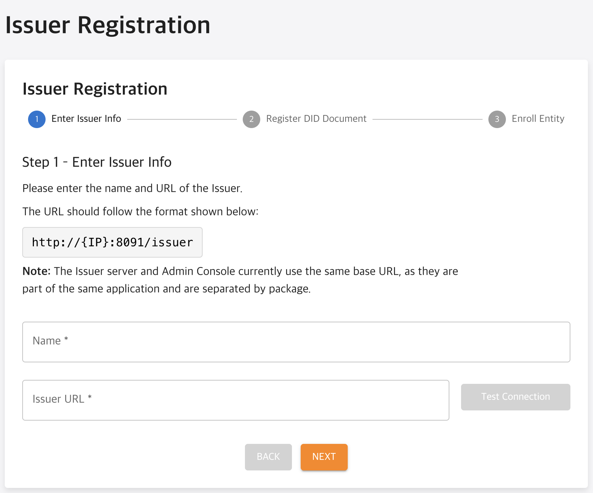

Issuer의 이름과 서버 URL을 입력하는 단계입니다.

- **Name**: 등록할 Issuer의 이름  
- **Issuer URL**: `http://{IP}:8091/issuer` 형식의 서버 엔드포인트  

> **Note**  
> Issuer 서버와 Admin Console은 같은 Base URL을 사용하며, 동일한 애플리케이션 내에서 패키지로 분리되어 있습니다.

- 모든 항목 입력 후 **NEXT** 버튼을 클릭하여 다음 단계로 이동합니다.

<br/>

### ▸ Step 2 – Register DID Document

Issuer의 DID Document를 생성하고, TAS(Trust Agent Service)에 등록 요청 및 승인을 받는 단계입니다. 아래 순서를 따릅니다:

<br/>

**1. Generate DID Document**  
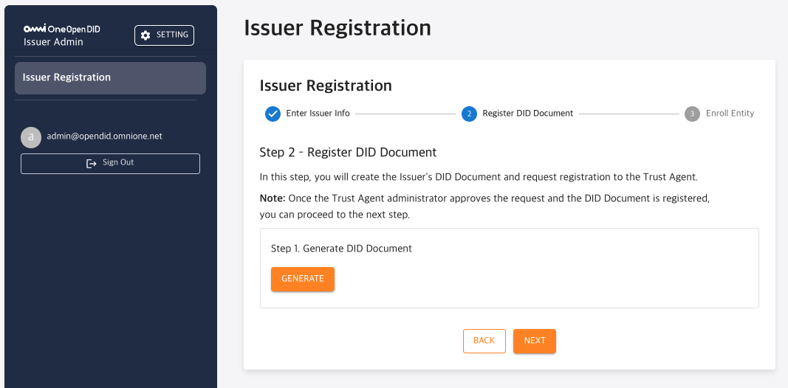  
`GENERATE` 버튼을 클릭하면 DID 문서가 자동 생성되며, 화면에 JSON 형식으로 출력됩니다.  
> 생성 완료 메시지: ✅ DID Document has been successfully created.

<br/>

**2. Submit Registration Request**  
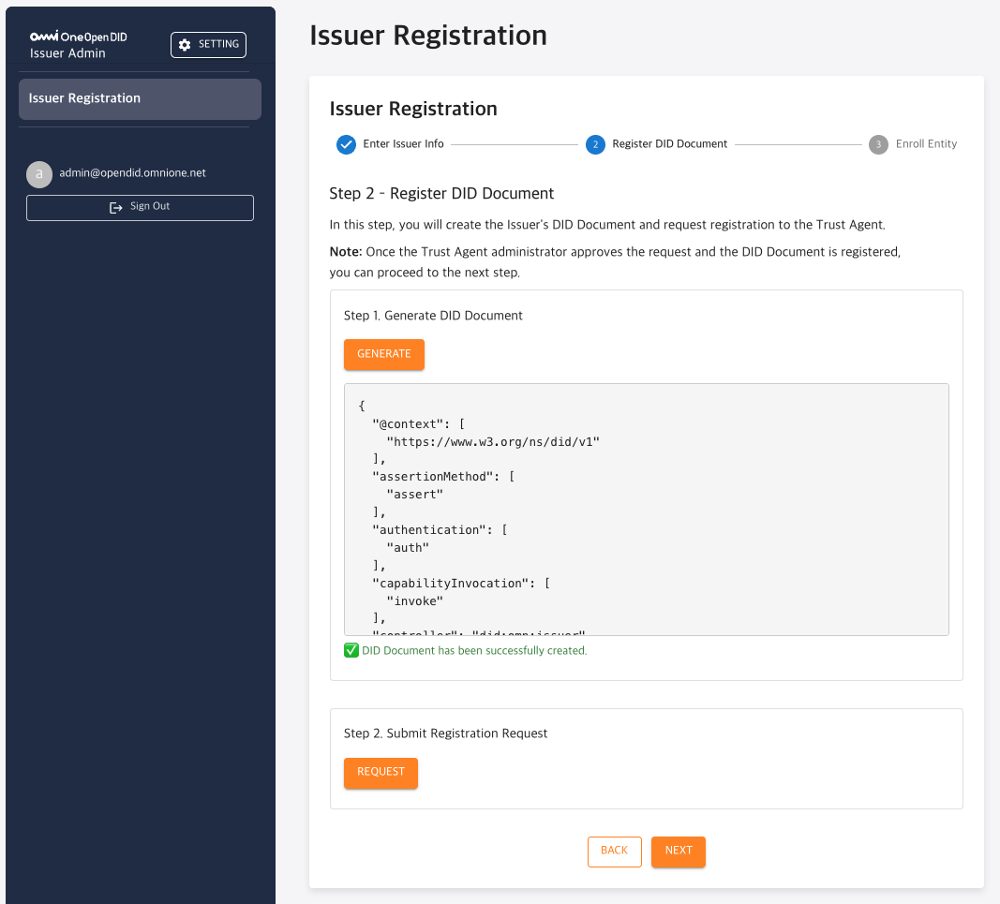  
`REQUEST` 버튼 클릭 시 TAS에 DID 문서 등록 요청이 전송됩니다.  
> 요청 완료 메시지: ✅ Registration request has been submitted.

<br/>

**3. Check Approval Status**  
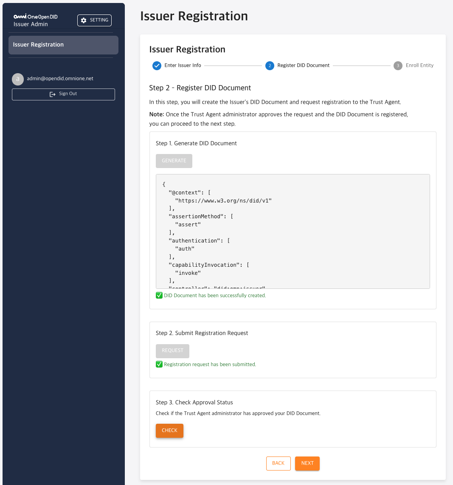  
`CHECK` 버튼을 클릭하여 TAS 관리자의 승인을 확인합니다.  
> 승인 완료 메시지: ✅ Approval confirmed. You can proceed.

<br/>

**4. 모든 과정을 완료한 화면**  
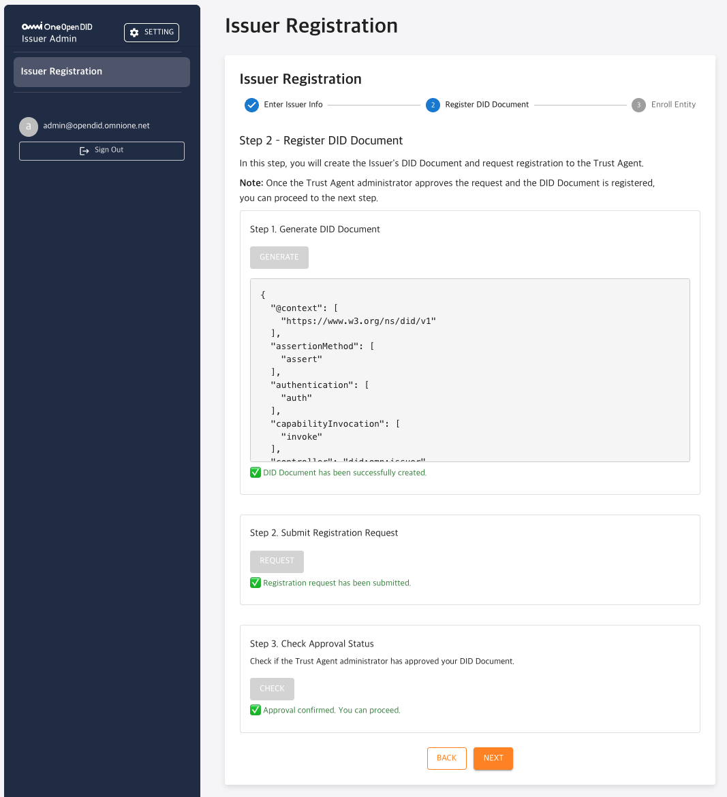

<br/>

### ▸ Step 3 – Register Entity and Issue Certificate VC

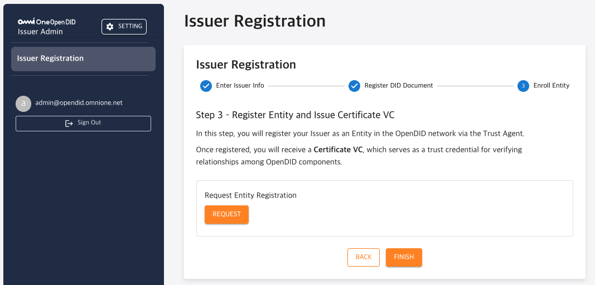

Issuer를 OpenDID 네트워크의 엔터티로 등록하고, **Certificate VC(신뢰 증명용 VC)**를 발급받는 마지막 단계입니다.

- `REQUEST` 버튼을 클릭하면 TAS를 통해 Entity가 등록됩니다.
- 등록이 완료되면 `FINISH` 버튼을 클릭하여 전체 등록을 마무리합니다.
- TAS가 Entity 등록 응답으로 Certificate VC의 공개 URL을 반환하면 Issuer 정보에 저장되며, [3.2. Issuer Management](#32-issuer-management)의 **Certificate URL**에 표시됩니다.

> **참고**  
> Certificate VC는 OpenDID 구성 요소 간의 신뢰 관계를 증명하는 자격 증명입니다.

<br/>

### ▸ 등록 완료 화면

모든 단계를 성공적으로 마치면 아래와 같이 완료 화면이 표시됩니다.

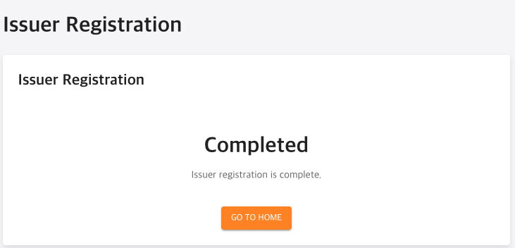

- "Completed" 메시지가 나타나며, `GO TO HOME` 버튼을 클릭하여 Admin Console 메인 화면으로 이동할 수 있습니다.


## 3.2. Issuer Management

Issuer Management는 Issuer 서버의 기본 정보를 등록하고 관리하는 메뉴입니다. Issuer는 VC(Verifiable Credential)의 발급 주체로서 시스템 내에서 고유한 DID를 가지고 등록되어야 하며, 최초 1회만 등록이 필요합니다.  

Issuer가 등록되면 시스템에 활성 상태(`ACTIVATE`)로 표시되며, 등록 이후에는 등록된 정보를 열람하거나 제한된 범위 내에서 변경할 수 있습니다.

Issuer Management 화면은 다음 항목들로 구성되어 있습니다.

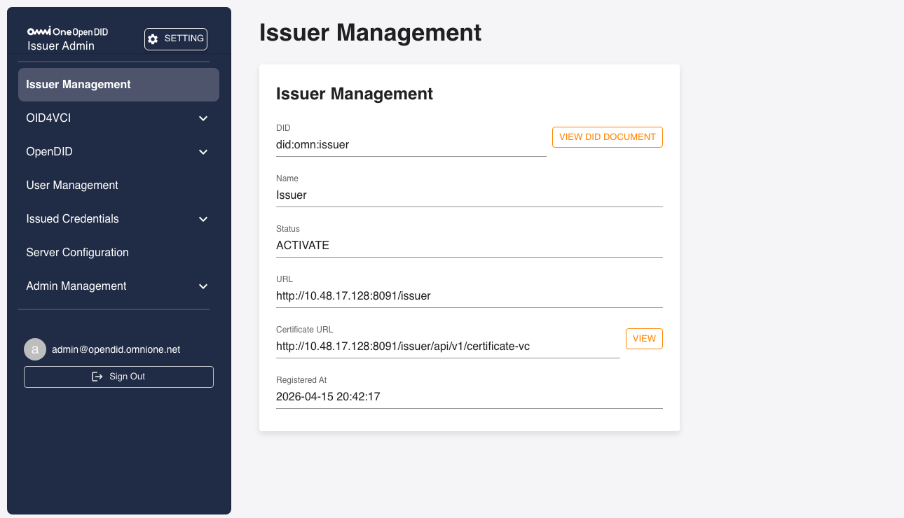

| 항목              | 설명                                                           |
|-------------------|----------------------------------------------------------------|
| **DID**           | Issuer를 식별하는 고유한 DID로, 시스템에서 자동 발급됩니다.     |
| **Name**          | 등록할 Issuer의 이름입니다.                                    |
| **Status**        | Issuer의 상태를 나타냅니다. 등록 완료 시 `ACTIVATE`로 표시됩니다. |
| **URL**           | Issuer 서버의 기본 URL입니다.                                  |
| **Certificate URL** | Issuer의 가입증명서(Certificate VC)를 조회할 수 있는 URL 주소입니다. |
| **Registered At** | Issuer의 최초 등록 일시입니다.                                 |

- DID Document는 화면의 `VIEW DID DOCUMENT` 버튼을 통해 확인할 수 있습니다.
- Certificate URL 옆의 `VIEW` 버튼을 클릭하면 Certificate VC 내용을 확인할 수 있습니다.
- 등록된 Issuer 정보는 삭제가 불가능하며, 일부 항목에 대해 제한된 범위 내에서만 수정이 가능합니다.

## 3.3. OID4VCI

OID4VCI 메뉴는 OID4VCI(OpenID for Verifiable Credential Issuance) 방식으로 SD-JWT VC(`dc+sd-jwt-did`)와 mdoc(`mso_mdoc-did`)을 발급하기 위한 설정을 관리합니다. Issuer가 활성화되면 표시되며 네 개의 하위 메뉴로 구성됩니다.

| 메뉴 | Route | 관리 데이터 |
|------|-------|-------------|
| Issuer Metadata | `/oid4vci-management/metadata` | Issuer URL, Authorization Server, Offer/Credential/Nonce/Revocation/Deferred/Notification Endpoint 및 암호화 기능 |
| Credential Configurations | `/oid4vci-management/credential-config` | Configuration ID, Format, Credential Identifier 및 Metadata JSON |
| Client Settings | `/oid4vci-management/property` | 공통, Android, iOS, Android OpenID, iOS OpenID Platform의 Client 설정 |
| List Provider | `/oid4vci-management/list-provider-registration` | 사용자 주도 Webview 발급에 사용하는 List Provider URL 및 등록 상태 |

저장 시 `/issuer/admin/v1/oid4vci/metadata`, `/credential-configs`, `/properties`, `/list-provider-registration` API를 호출합니다. Endpoint 변경은 공개 Metadata와 동적으로 등록되는 발급 Endpoint에 영향을 주므로 저장 전 URL을 검증해야 합니다.

### 3.3.1. Issuer Metadata

OID4VCI 발급자 Metadata(`/.well-known/openid-credential-issuer`)에 공개되는 Endpoint와 Credential 요청·응답 암호화 지원 정보를 조회하고 수정하는 화면입니다.

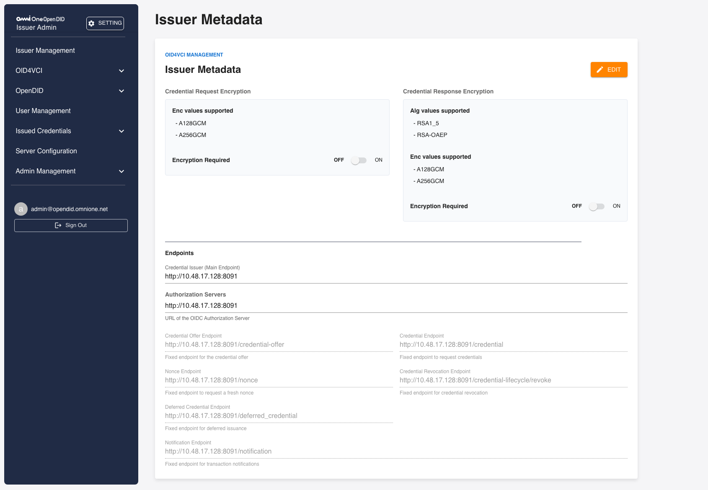

| 번호 | 항목 | 설명 |
| ---- | ---- | ---- |
| 1 | **EDIT 버튼** | Issuer Metadata를 수정할 수 있는 편집 모드로 전환합니다. |
| 2 | **Credential Request Encryption** | Credential 요청에 사용할 콘텐츠 암호화 방식과 암호화 필수 여부를 설정합니다. |
| 3 | **Credential Response Encryption** | Credential 응답에 사용할 키 암호화 및 콘텐츠 암호화 방식과 암호화 필수 여부를 설정합니다. |
| 4 | **Credential Issuer (Main Endpoint)** | OID4VCI Credential Issuer의 기준 URL입니다. |
| 5 | **Authorization Servers** | 인증 및 인가를 처리하는 OIDC Authorization Server URL 목록입니다. |
| 6 | **Credential Offer Endpoint** | Credential Offer를 제공하는 Endpoint입니다. |
| 7 | **Credential Endpoint** | Credential 발급 요청을 처리하는 Endpoint입니다. |
| 8 | **Nonce Endpoint** | 새로운 `c_nonce`를 요청하는 Endpoint입니다. 발급된 `c_nonce`는 한 번만 사용할 수 있습니다. |
| 9 | **Credential Revocation Endpoint** | Wallet이 보유한 Credential의 폐기를 요청하는 Endpoint입니다. `{Credential Issuer}/credential-lifecycle/revoke`로 고정됩니다. |
| 10 | **Deferred Credential Endpoint** | 지연 발급 Credential 요청을 처리하는 Endpoint입니다. |
| 11 | **Notification Endpoint** | Credential 발급 결과 알림을 처리하는 Endpoint입니다. |

> **참고:**  
> - 편집 모드에서는 **SAVE** 버튼으로 변경 사항을 저장하거나 **CANCEL** 버튼으로 수정을 취소할 수 있습니다.  
> - Offer, Credential, Nonce, Revocation, Deferred, Notification Endpoint는 고정값으로 표시되며 직접 수정할 수 없습니다.  
> - Credential Revocation Endpoint의 요청 형식은 [Issuer API 문서](../api/Issuer_API_ko.md)를 참고하세요.  
> - 공개 Metadata의 `credential_configurations_supported`는 [3.3.2. Credential Configurations](#332-credential-configurations)에 등록된 값으로 구성됩니다.

---

### 3.3.2. Credential Configurations

OID4VCI로 발급할 Credential의 Configuration을 조회하고 등록·수정·삭제하는 화면입니다.

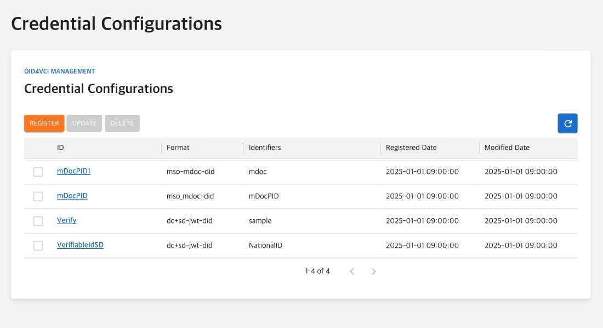

| 번호 | 항목 | 설명 |
| ---- | ---- | ---- |
| 1 | **REGISTER 버튼** | 새로운 Credential Configuration을 등록하는 화면으로 이동합니다. |
| 2 | **UPDATE 버튼** | 선택한 Credential Configuration의 상세 화면으로 이동하여 설정을 수정합니다. |
| 3 | **DELETE 버튼** | 선택한 Credential Configuration을 삭제합니다. |
| 4 | **ID** | Credential Configuration의 고유 식별자입니다. ID를 클릭하면 상세 화면으로 이동합니다. |
| 5 | **Format** | 발급할 Credential 형식입니다. (`mso_mdoc-did`, `dc+sd-jwt-did`) |
| 6 | **Identifiers** | SDK에서 Credential을 식별할 때 사용하는 Identifier 목록입니다. |
| 7 | **Registered Date** | Credential Configuration이 등록된 일시입니다. |
| 8 | **Modified Date** | Credential Configuration이 마지막으로 수정된 일시입니다. |

#### ▸ Credential Configuration 등록

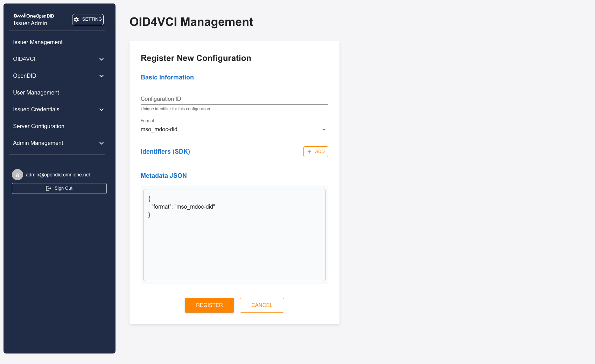

| 항목 | 설명 |
| ---- | ---- |
| **Configuration ID** | Configuration의 고유 식별자입니다. 등록 시에만 입력할 수 있습니다. |
| **Format** | `mso_mdoc-did` 또는 `dc+sd-jwt-did` 중 선택합니다. 기본값은 `mso_mdoc-did`입니다. |
| **Identifiers (SDK)** | SDK가 Credential을 식별할 때 사용하는 Identifier입니다. `ADD` 버튼으로 여러 개를 등록할 수 있습니다. |
| **Metadata JSON** | Issuer Metadata의 `credential_configurations_supported`에 공개할 JSON 객체입니다. |

- `REGISTER` 버튼으로 저장하고, `CANCEL` 버튼으로 목록으로 돌아갑니다.
- Metadata JSON은 JSON 객체 형식이어야 하며, 배열이나 문자열 등은 저장할 수 없습니다.

#### ▸ Credential Configuration 상세 / 수정

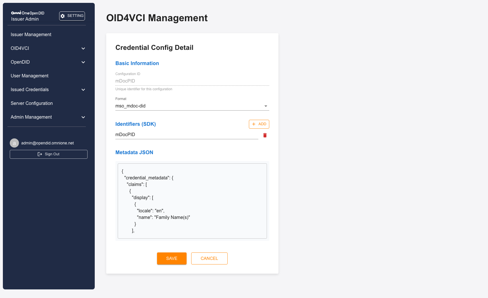

- 목록에서 ID를 클릭하거나 행을 선택한 뒤 `UPDATE` 버튼을 클릭하면 상세 화면으로 이동합니다.
- Configuration ID는 수정할 수 없으며, Format, Identifiers, Metadata JSON을 수정한 뒤 `SAVE` 버튼으로 저장합니다.

> **참고:** Credential Configuration은 Credential Configuration 저장소에만 저장되고, 공개 Issuer Metadata의 `credential_configurations_supported`는 조회 시 저장된 Configuration으로 구성됩니다. 따라서 Configuration을 등록·수정·삭제할 때 Issuer Metadata를 별도로 수정할 필요가 없습니다.

---

### 3.3.3. Client Settings

OID4VCI 발급 과정에서 사용하는 공통 및 Platform별 Client 설정을 관리하는 화면입니다.

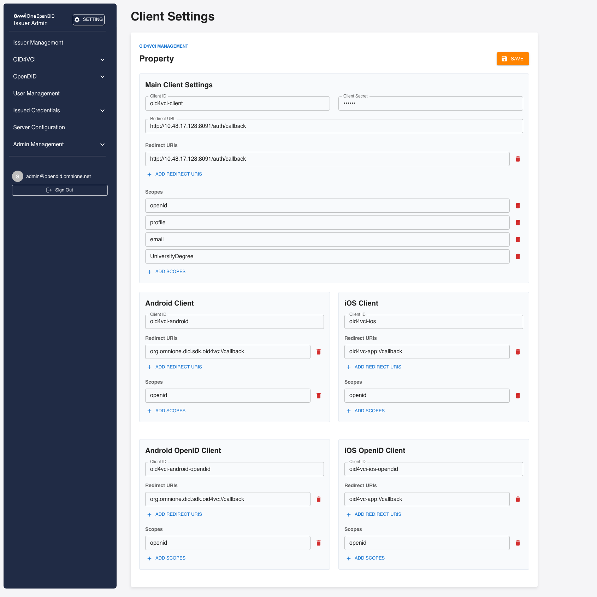

| 번호 | 항목 | 설명 |
| ---- | ---- | ---- |
| 1 | **SAVE 버튼** | 화면에 입력한 Client 설정을 저장합니다. |
| 2 | **Main Client Settings** | 공통으로 사용하는 Client ID, Client Secret, Redirect URL, Redirect URIs 및 Scope를 설정합니다. |
| 3 | **Android Client** | Android 환경에서 사용할 Client ID, Redirect URI 및 Scope를 설정합니다. |
| 4 | **iOS Client** | iOS 환경에서 사용할 Client ID, Redirect URI 및 Scope를 설정합니다. |
| 5 | **Android OpenID Client** | Android OpenID 방식에서 사용할 Client ID, Redirect URI 및 Scope를 설정합니다. |
| 6 | **iOS OpenID Client** | iOS OpenID 방식에서 사용할 Client ID, Redirect URI 및 Scope를 설정합니다. |

---

### 3.3.4. List Provider

사용자 주도 Webview 발급에 사용할 Issuer 정보를 List Provider에 등록하고 처리 상태를 확인하는 화면입니다.

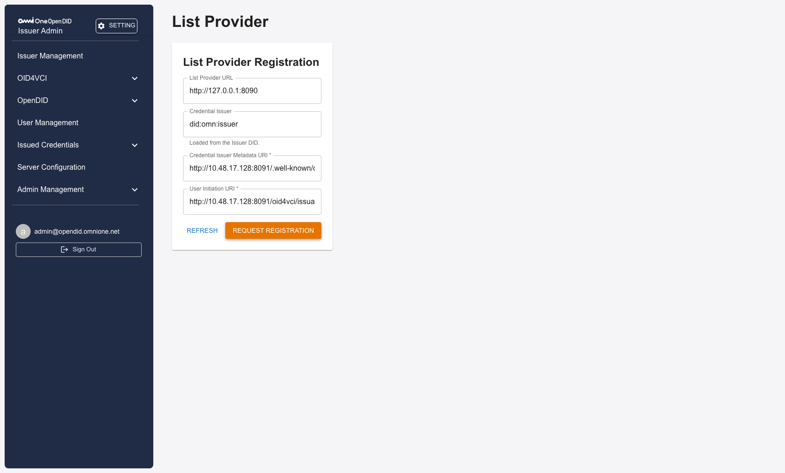

| 번호 | 항목 | 설명 |
| ---- | ---- | ---- |
| 1 | **Registration Status** | 등록 요청 시 List Provider가 반환한 상태(`REQUESTED`)를 표시합니다. 등록 요청 전에는 표시되지 않습니다. |
| 2 | **List Provider URL** | 등록 요청을 전송할 List Provider의 URL입니다. (읽기 전용) |
| 3 | **Credential Issuer** | Issuer DID 정보에서 불러온 Credential Issuer 식별자입니다. (읽기 전용) |
| 4 | **Credential Issuer Metadata URI** | List Provider가 Issuer Metadata를 조회할 수 있는 URI입니다. HTTP(S) 형식이어야 합니다. |
| 5 | **User Initiation URI** | 사용자가 Webview 발급 절차를 시작할 때 사용하는 URI입니다. HTTP(S) 형식이어야 합니다. |
| 6 | **REFRESH 버튼** | Issuer에 저장된 등록 정보를 다시 조회합니다. |
| 7 | **REQUEST REGISTRATION 버튼** | 확인 다이얼로그를 거쳐 입력한 정보로 List Provider에 등록을 요청합니다. 요청 후에는 입력값과 버튼이 비활성화됩니다. |

> **참고:** 등록 요청은 List Provider(TAS) 관리자가 승인(`ACTIVE`)하거나 반려(`REJECTED`)하며, 승인 후에는 `SUSPENDED`, `REVOKED`로 바뀔 수 있습니다. 이 화면은 요청 시점의 상태만 저장하므로 이후 TAS에서 바뀐 상태는 표시되지 않습니다. 현재 상태는 TAS Admin Console에서 확인하세요.

---

## 3.4. OpenDID - VC

OpenDID > VC 메뉴는 OpenDID 프로토콜로 Issuer가 발급하는 VC(Verifiable Credential)를 정의하고 관리하기 위한 메뉴입니다. VC를 발급하기 위해서는 사전에 Namespace와 VC Schema를 등록하여 VC 구조를 정의하고, 발급 정책(Issuance Profile)을 설정해야 합니다.

다음 세 가지 하위 메뉴로 구성되어 있습니다.

- Namespaces
- VC Schemas
- Issuance Profiles

---

### 3.4.1. Namespaces

Namespaces는 VC의 구조를 정의할 때 사용되는 네임스페이스(Namespace)를 등록하고 관리하는 메뉴입니다.  
Namespace는 **하나의 VC에 포함될 Claim(속성) 항목들을 그룹화한 논리적 단위**로, 각 항목은 `ID`, `Type`, `Format`, `Caption` 정보를 포함합니다.

등록된 Namespace는 이후 VC Schema를 생성할 때 포함 항목으로 선택되어 **VC의 데이터 구조를 구성하는 기반**이 됩니다. 또한, Issuance Profile 생성 시에도 간접적으로 참조되며,  
**사용자 VC 발급 시 입력해야 할 항목들의 기준을 정의하는 핵심 요소**입니다.

즉, Namespace는 전체 VC 발급 시스템에서 다음과 같은 흐름으로 활용됩니다:

1. **Namespace 등록** – VC에 포함될 항목 정의  
2. **VC Schema 생성 시 Namespace를 선택하여 구조 정의**  
3. **Issuance Profile 등록 시 VC Schema를 참조**  
4. **사용자 등록 시 VC 데이터(JSON) 입력 기준으로 활용**

> 본 메뉴는 **Issuer 등록 후 사용 가능**합니다. VC Schema 및 Issuance Profile 등록 시 참조되므로, **최초로 구성되어야 할 항목**입니다.

#### ▸ Namespace 목록

Namespace 목록 화면에서는 등록된 네임스페이스들을 확인할 수 있습니다.

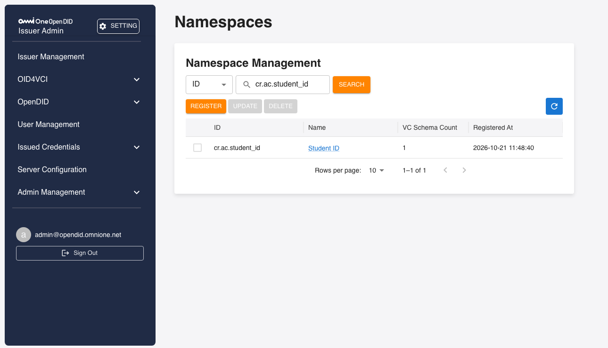

| 항목                  | 설명                                |
|---------------------|-----------------------------------|
| **ID**              | 네임스페이스의 고유 식별자입니다.                |
| **Name**            | 네임스페이스 이름입니다. 클릭 시 상세 화면으로 이동합니다. |
| **VC Schema Count** | 네임스페이스를 참조하는 VC Schema의 수 입니다.    |
| **Registered At**   | 네임스페이스가 등록된 일시입니다.                |

- `REGISTER` 버튼을 클릭하면 네임스페이스를 새로 등록할 수 있습니다.
- 네임스페이스를 선택한 후 `UPDATE` 버튼을 클릭하면 해당 네임스페이스를 수정할 수 있습니다.
   >네임스페이스를 사용하는 VC Schema가 없을 경우 수정할 수 있습니다.
  >VC Schema에서 해당 네임스페이스를 참조하고 있을 경우 수정할 수 없습니다.


#### ▸ Namespace 등록

네임스페이스 등록 화면에서는 다음 정보를 입력하여 네임스페이스를 생성합니다.

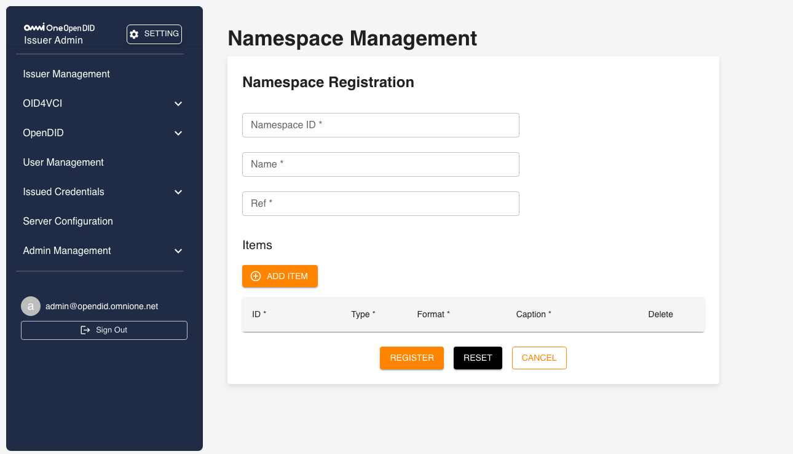

| 항목            | 설명                                              |
|-----------------|---------------------------------------------------|
| **Namespace ID**| 네임스페이스의 고유 식별자(예: `iso.18013.5`)입니다.|
| **Name**        | 네임스페이스 이름입니다.                           |
| **Ref**         | 네임스페이스와 관련된 참조 URL 또는 설명입니다.      |
| **Items**       | 네임스페이스에 포함될 항목입니다. 다음 필드로 구성됩니다:<br>-`ID`, `Type`, `Format`, `Caption`|

- `ADD ITEM` 버튼으로 항목을 추가하며, 항목 삭제 및 수정도 가능합니다.
- 입력 후 `REGISTER` 버튼을 클릭하여 등록합니다.

#### ▸ Namespace 상세 정보

네임스페이스 목록에서 이름을 클릭하면 상세 정보를 확인할 수 있습니다.

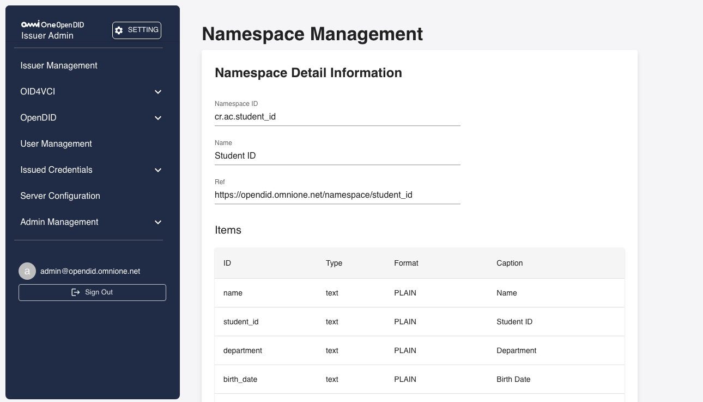

| 항목            | 설명                             |
|-----------------|----------------------------------|
| **Namespace ID**| 네임스페이스 고유 식별자입니다.  |
| **Name**        | 네임스페이스 이름입니다.         |
| **Ref**         | 참조 URL 또는 설명입니다.        |
| **Items**       | 등록된 항목 목록입니다. 각 항목은 ID, Type, Format, Caption으로 구성됩니다.|

#### ▸ Namespace 수정 (Update)

네임스페이스의 기존 정보를 수정할 수 있는 화면입니다.

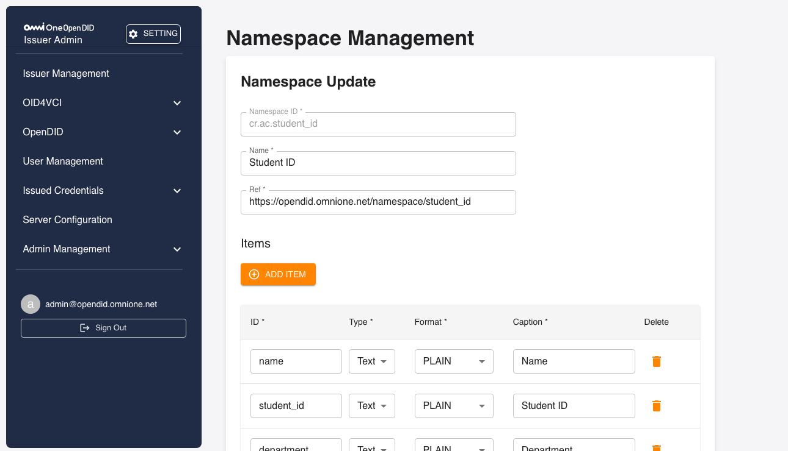

| 항목             | 설명                                   |
|------------------|----------------------------------------|
| **Namespace ID** | 고유 식별자이므로 수정할 수 없습니다.  |
| **Name**         | 네임스페이스 이름을 수정할 수 있습니다. |
| **Ref**          | 참조 URL 또는 설명을 수정할 수 있습니다.|
| **Items**        | 등록된 항목을 추가, 수정, 삭제할 수 있습니다.|

- 변경 사항 수정 후 `UPDATE` 버튼을 클릭하여 저장합니다.
- `RESET` 버튼은 폼을 초기 상태로 되돌리며, `BACK` 버튼으로 상세보기 화면으로 이동할 수 있습니다.

---

### 3.4.2. VC Schemas

VC Schemas는 Verifiable Credential(VC)의 데이터 구조를 정의하는 **VC Schema**를 등록하고 관리하는 메뉴입니다.

VC Schema는 **VC 내에 포함될 데이터 필드(Claim)의** 구성과 형식을 정의하는 스키마 문서로,  
사전에 등록한 **Namespace에 정의된 Claim 항목들을 조합하여 생성**됩니다.  
즉, VC Schema는 Namespace를 기반으로 만들어지며, **어떤 정보가 VC에 담길지 명확히 규정**합니다.

등록된 VC Schema는 이후 **Issuance Profile 생성 시 참조**되며,  
발급 대상 사용자 정보를 입력할 때는 이 Schema를 기준으로 VC JSON 구조가 결정됩니다.  
이로 인해 VC Schema는 **VC 발급의 핵심 기준점 역할**을 하며, 다음과 같은 흐름으로 사용됩니다:

1. **Namespace 등록** – Claim 항목 정의  
2. **VC Schema 등록** – Namespace를 기반으로 VC 구조 정의  
3. **Issuance Profile 등록 시 VC Schema 선택**  
4. **사용자 등록 시 Schema 기준으로 JSON 데이터 입력**  
5. **VC 발급 시 Schema를 기반으로 실제 VC 생성**

> 본 메뉴는 **Issuer 등록 및 Namespace 선행 등록 후 사용 가능합니다.**  
> VC Schema 등록 시 Schema가 Ledger(블록체인 또는 Ledger Service Server)에 함께 등록되므로, 연동 서버가 실행 중이어야 합니다.

#### ▸ VC Schema 목록

등록된 VC Schema 목록을 확인합니다.

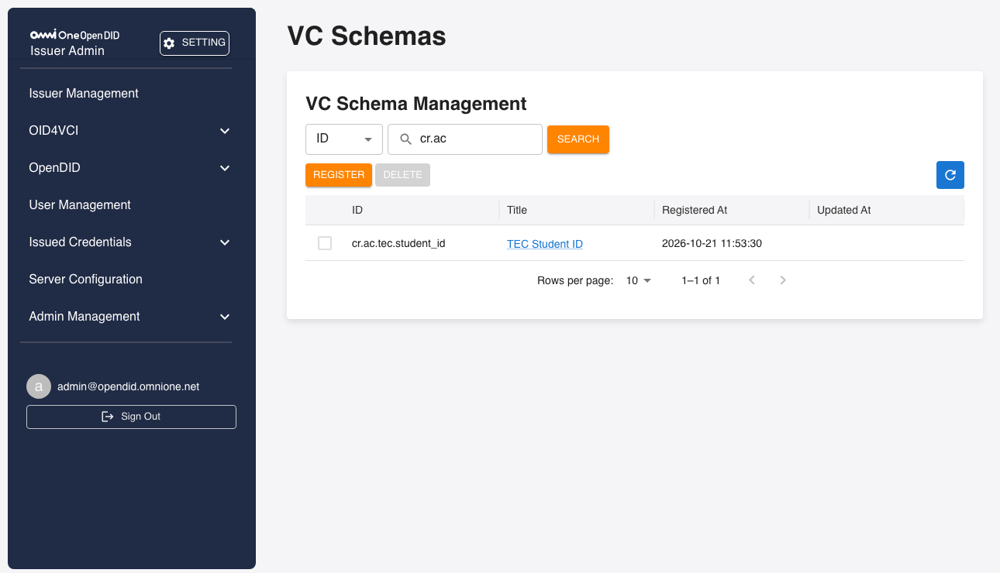

| 항목            | 설명                             |
|-----------------|----------------------------------|
| **ID**          | VC Schema의 고유 식별자입니다.   |
| **Title**       | 스키마의 제목입니다. 클릭 시 상세 화면으로 이동합니다.|
| **Registered At**| 최초 등록된 일시입니다.          |
| **Updated At**  | 마지막 수정된 일시입니다.         |

- `REGISTER` 버튼을 클릭하여 새 VC Schema를 등록할 수 있습니다.

#### ▸ VC Schema 등록

새로운 VC Schema를 등록합니다.

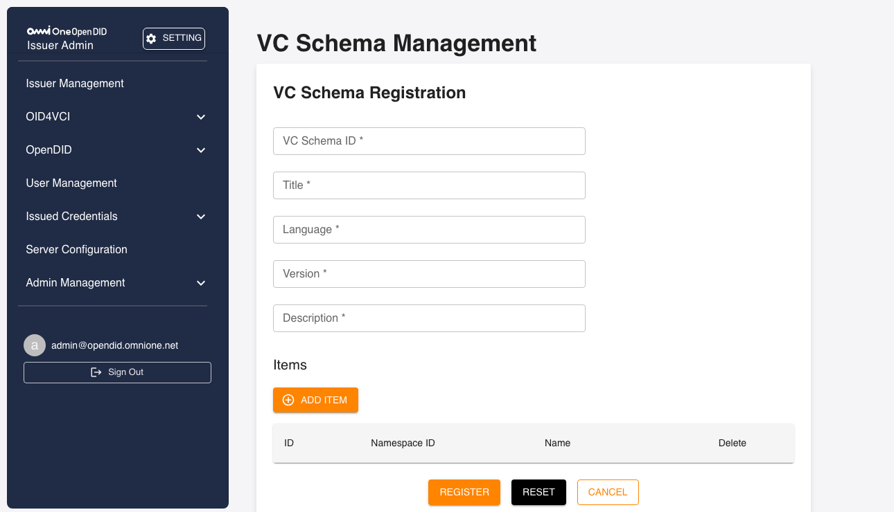

| 항목            | 설명                                        |
|-----------------|---------------------------------------------|
| **VC Schema ID**| VC Schema의 고유 식별자 또는 URL입니다.      |
| **Title**       | 스키마의 제목입니다.                         |
| **Language**    | VC Schema 언어(예: `ko`)입니다.                   |
| **Version**     | 스키마 버전입니다.                           |
| **Description** | VC Schema에 대한 설명입니다.                 |
| **Items**       | Schema에 포함될 네임스페이스 기반 항목 목록입니다.|

- 입력 완료 후 `REGISTER` 버튼으로 등록합니다.

#### ▸ VC Schema 상세 정보

VC Schema 목록에서 제목을 클릭하면 스키마의 상세 정보를 확인할 수 있습니다.

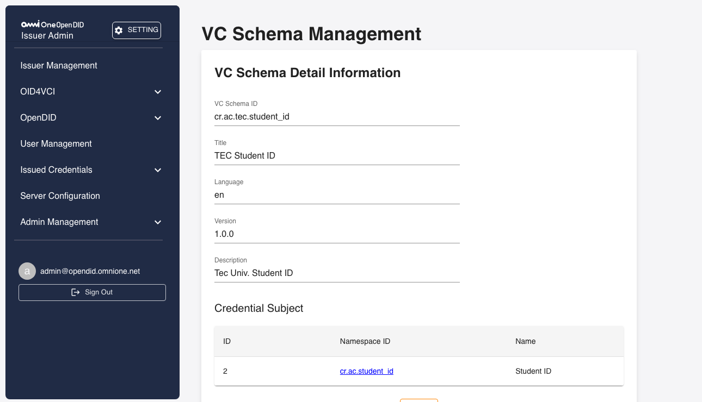

| 항목                 | 설명                                                    |
|----------------------|---------------------------------------------------------|
| **VC Schema ID**     | VC Schema를 식별하는 고유한 URL 또는 ID입니다.          |
| **Title**            | VC Schema의 제목입니다.                                 |
| **Language**         | 스키마 설명 언어 설정입니다. (예: `ko`)                 |
| **Version**          | 스키마의 버전 정보입니다.                               |
| **Description**      | 스키마에 대한 상세 설명입니다.                          |
| **Credential Subject** | VC Schema에 포함된 Namespace 목록입니다. 항목을 클릭하면 해당 Namespace 상세 정보를 확인할 수 있습니다. |

---

### 3.4.3. Issuance Profiles

Issuance Profiles는 Verifiable Credential(VC) 발급을 위한 **발급 프로파일(Issue Profile)을** 정의하고 관리하는 메뉴입니다.

Issue Profile은 발급 대상 VC의 스키마(VC Schema)와 발급 방식(예: User/Issuer Initiate), 발급 경로(Direct/Proxy), 사용자 정보 조회 방식, 보안 설정 등을 하나의 단위로 묶은 **VC 발급 정책**입니다.  

VC를 실제로 발급하려면 반드시 해당 VC Schema를 기반으로 한 Issue Profile이 등록되어 있어야 하며,  
VC 발급 시 시스템은 이 Profile을 참조하여 발급 절차, 구조, 보안 설정을 자동 구성합니다.

Issue Profile은 다음과 같은 요소로 구성됩니다:

- 참조할 VC Schema ID
- VC 발급 방식 (`User Initiate`, `Issuer Initiate`)
- 발급 경로 (`Direct`, `Proxy`)
- 발급 시 사용할 Endpoint 주소 목록
- E2E(End-to-End) 암호화 설정
- 사용자 정보 조회 방식 (`DB`, `TEST`)
- (선택) ZKP 발급 여부 및 Credential Definition ID

> **ZKP Credential을 발급하고자 하는 경우**, 반드시 ZKP Credential Definition이 사전에 등록되어 있어야 하며,  
Issue Profile 생성 시 해당 Definition ID를 연결해야 ZKP Credential을 포함해서 발급받을 수 있습니다.

#### 사용 흐름

1. **Namespace 등록** → Claim 정의  
2. **VC Schema 등록** → 구조 정의  
3. **Credential Definition 등록 (ZKP 발급 시)**  
4. **Issue Profile 등록** → VC 발급 정책 정의  
5. **User 등록 및 VC 발급**

> 하나의 VC Schema에 대해 여러 Issue Profile을 정의할 수 있으며,  
> 사용 목적에 따라 발급 방식과 보안 설정을 달리 구성할 수 있습니다. (예: 일반 사용자용 vs 테스트용)

> 본 메뉴는 **Issuer 등록, Namespace 및 VC Schema 등록이 완료된 후 사용 가능합니다.**  
> ZKP 기반 VC를 발급하려면 Credential Definition 등록 또한 선행되어야 합니다.

#### Issuance Mode와 User Query Method

| 항목 | 값 | 설명 |
| ---- | -- | ---- |
| **Issuance Mode** | `Direct` | Wallet이 Issuer에 직접 VC 발급을 요청하는 기본 발급 경로입니다. |
| | `Proxy` | 중계 서버를 거쳐 VC를 발급하는 경로입니다. 발급 프로파일 생성 요청에 Holder 대신 사용자 ID가 전달되며, Issuer는 KYC 서버에서 사용자 PII를 조회하고 Holder의 DID Auth 서명을 검증합니다. |
| **User Query Method** | `DB` (기본값) | 사전에 User Management에 등록된 사용자 정보(VC Claim)를 사용합니다. 기존 Issue Profile은 `DB`로 동작합니다. |
| | `TEST` | 사용자 정보를 미리 등록하지 않아도 VC Schema를 기준으로 테스트용 Claim을 자동 생성하여 발급합니다. 개발·검증 환경에서만 사용하세요. |

> **참고:** Demo 서버의 VC 정보 입력 팝업에서 `Skip` 링크로 입력을 생략할 수 있습니다. `TEST` 방식은 Claim이 자동 생성되므로 발급이 계속 진행되지만, `DB` 방식에서 Skip하면 사용자 정보가 없어 발급 단계에서 실패할 수 있습니다.

#### ▸ Issue Profile 목록

등록된 Issue Profile 목록을 확인할 수 있습니다.

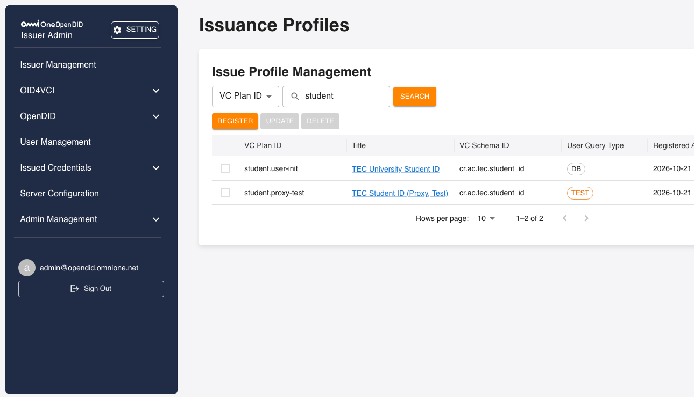

| 항목            | 설명                                             |
|-----------------|--------------------------------------------------|
| **VC Plan ID**  | Issue Profile을 식별하는 고유한 ID입니다.|
| **Title**       | 프로파일의 제목입니다. 클릭 시 상세 화면으로 이동합니다.|
| **VC Schema ID**| 연결된 VC Schema의 ID입니다.|
| **User Query Type** | 사용자 정보 조회 방식(`DB`, `TEST`)입니다. |
| **Registered At**| Issue Profile이 등록된 일시입니다.               |

- `REGISTER` 버튼을 클릭하여 새로운 Issue Profile을 등록할 수 있습니다.
- 항목을 선택한 뒤 `UPDATE` 버튼으로 수정 화면, `DELETE` 버튼으로 삭제를 수행합니다.

#### ▸ Issue Profile 등록

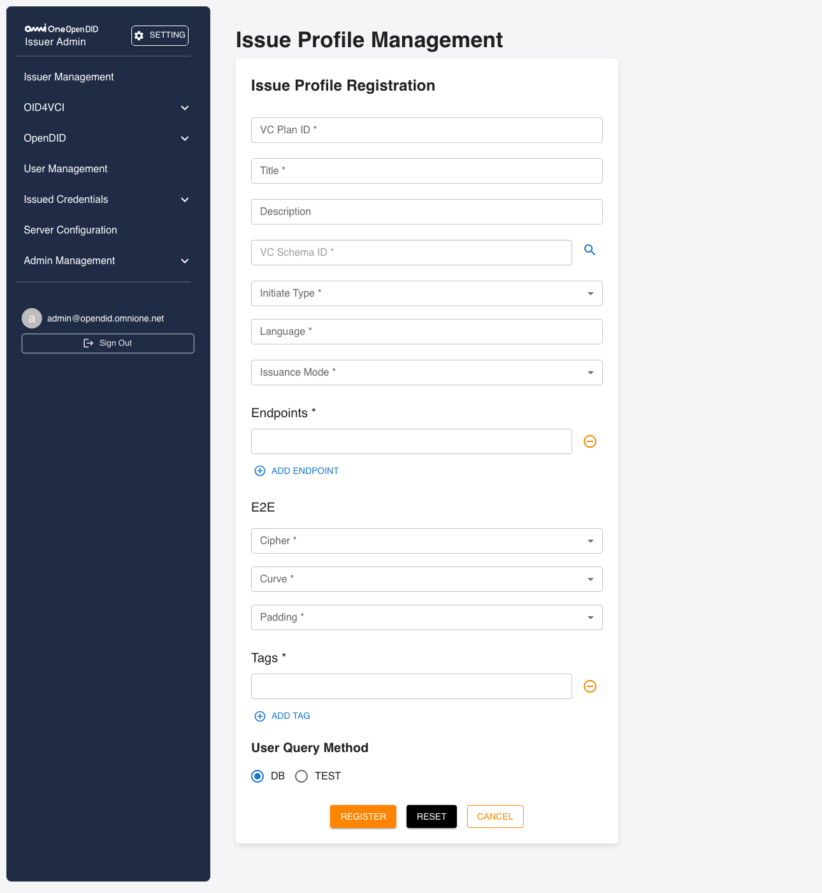

| 항목               | 설명                                                                 |
|--------------------|----------------------------------------------------------------------|
| **VC Plan ID**     | 발급 프로파일의 고유 식별자입니다.                                   |
| **Title**          | 발급 프로파일의 제목입니다.                                           |
| **Description**    | 프로파일의 상세 설명입니다.                              |
| **VC Schema ID**   | 연동할 VC Schema의 ID입니다. (돋보기 버튼으로 선택 가능)              |
| **Initiate Type**  | VC 발급 요청의 시작 방식 설정<br/>(예: User Initiate, Issuer Initiate)|
| **Language**       | 프로파일의 언어 설정입니다. (예: `ko`)                                |
| **Issuance Mode**  | 발급 경로를 선택합니다. (`Direct`, `Proxy`) |
| **Endpoints**      | VC 발급 요청을 수신할 Endpoint 주소 목록입니다.                       |
| **E2E**            | End-to-End 암호화 구성<br/>- Cipher, Curve, Padding 설정 가능          |
| **Tags**           | 해당 프로파일을 구분하거나 검색 시 활용할 태그 정보입니다.             |
| **User Query Method** | 사용자 정보 조회 방식을 선택합니다. (`DB`, `TEST`, 기본값 `DB`) |
| **ZKP 발급 여부**  | `Issuer Initiate` 방식인 경우, ZKP 기반 발급 여부를 설정할 수 있습니다. |
| **Credential Definition ID** | ZKP 발급 시 참조할 Credential Definition ID를 입력합니다.     |

- `ZKP 발급 여부` 스위치를 켜면 Definition ID 입력 필드가 활성화됩니다.
- 모든 항목 입력 후 `REGISTER` 버튼 클릭 시 프로파일이 등록됩니다.  
- `RESET` 버튼은 폼을 초기화하고, `CANCEL`은 등록을 취소합니다.

#### ▸ Issue Profile 상세 정보

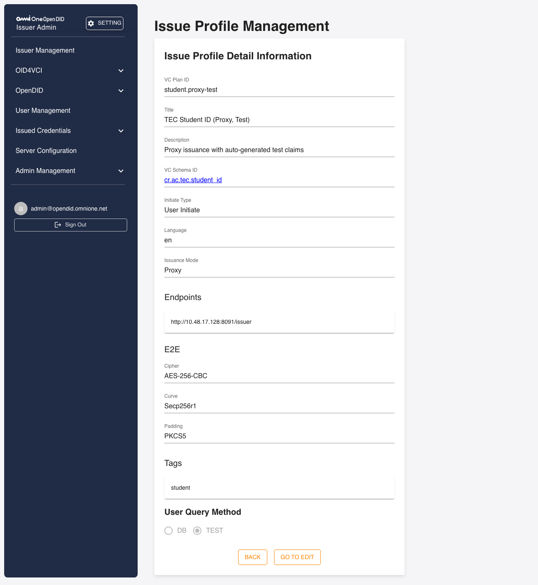

- 등록된 Issue Profile의 상세 정보를 확인할 수 있습니다.
- `ZKP 발급 여부`가 설정된 경우, 관련 Definition ID가 하단에 표시됩니다.

| 항목                     | 설명                                                  |
|--------------------------|-------------------------------------------------------|
| **VC Plan ID**           | 발급 프로파일의 고유 식별자                          |
| **Title**                | 프로파일의 제목                                       |
| **Description**          | 프로파일 설명                                         |
| **VC Schema ID**         | 연결된 VC Schema의 ID                                 |
| **Initiate Type**        | 발급 시작 방식 (`Issuer Initiate`, `User Initiate`)   |
| **Language**             | 프로파일 언어                                         |
| **Issuance Mode**        | 발급 경로 (`Direct`, `Proxy`)                         |
| **Endpoints**            | 발급 요청을 수신할 Endpoint 목록                      |
| **E2E**                  | Cipher, Curve, Padding 설정                           |
| **Tags**                 | 태그 정보                                             |
| **User Query Method**    | 사용자 정보 조회 방식 (`DB`, `TEST`)                  |
| **ZKP Definition ID**    | ZKP 기반 발급에 사용될 Credential Definition ID       |

- `GO TO EDIT` 버튼 클릭 시 수정 화면으로 이동할 수 있습니다.

#### ▸ Issue Profile 수정 (Update)

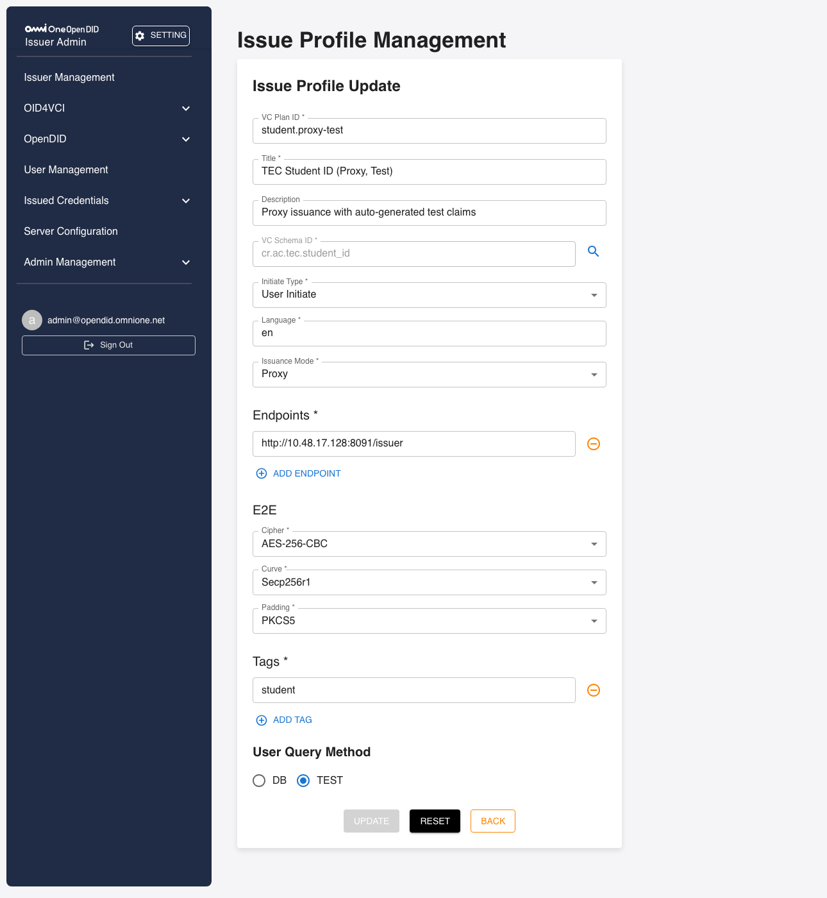

- 등록된 Issue Profile의 내용을 수정할 수 있습니다.
- Initiate Type이 `Issuer Initiate`일 경우에만 `ZKP 발급 여부` 설정이 표시됩니다.

| 항목                     | 설명                                                  |
|--------------------------|-------------------------------------------------------|
| **VC Plan ID**           | 수정할 수 없습니다.                                   |
| **Title**                | 프로파일의 제목 수정 가능                             |
| **VC Schema ID**         | 이미 연동된 VC Schema는 수정 불가                     |
| **Initiate Type**        | 발급 시작 방식 수정 가능                              |
| **Language**             | 언어 설정 수정 가능                                   |
| **Issuance Mode**        | 발급 경로 수정 가능                                   |
| **Endpoints**            | 추가 및 수정 가능                                     |
| **E2E**                  | Cipher, Curve, Padding 수정 가능                      |
| **Tags**                 | 태그 추가/삭제 가능                                   |
| **User Query Method**    | 사용자 정보 조회 방식 수정 가능                       |
| **ZKP 발급 여부**        | 발급 방식이 Issuer Initiate일 때만 설정 가능           |
| **Credential Definition ID** | ZKP 발급 시 사용되는 Definition ID 지정             |

- 변경 사항 저장은 `UPDATE` 버튼을 통해 수행합니다.
- `RESET`은 입력값을 초기화, `BACK`은 상세 보기 화면으로 이동합니다.

---

## 3.5. OpenDID - ZKP

OpenDID > ZKP 메뉴는 **Zero-Knowledge Proof (ZKP)** 기반 Credential 발급을 위한 구성 요소들을 등록하고 관리하는 기능을 제공합니다.  
ZKP는 **이용자의 민감한 정보를 직접 공개하지 않고도 특정 정보를 증명할 수 있는 방식**으로, 보다 **프라이버시 친화적인 VC 발급**을 가능하게 합니다.

ZKP 기반 발급을 구성하기 위해서는 다음 세 가지 등록 절차가 반드시 선행되어야 하며,  
이 과정을 통해 생성된 정보는 이후 **Issuance Profile 등록 시** ZKP 발급 항목에서 참조됩니다:

1. **ZKP Namespace 등록** – VC에 포함될 Claim(속성) 정의  
2. **Credential Schema 등록** – Namespace 기반으로 ZKP VC 구조 정의  
3. **Credential Definition 등록** – 실제 VC 발급에 사용될 스키마 기반 정의  
   → 이 정의는 ZKP 네트워크에서 사용될 고유한 Definition ID를 생성합니다.

ZKP 메뉴는 위 절차를 단계별로 지원하며, 일반 VC Schema 관리와는 별도로 구성되어 있습니다.

#### ▸ ZKP VC 발급 흐름 요약

1. **ZKP Namespace 등록**  
2. → **ZKP Credential Schema 등록 (Namespace 기반)**  
3. → **ZKP Credential Definition 등록 (Schema 기반)**  
4. → **Issuance Profile 생성 시, ZKP 발급 옵션 활성화 및 Definition ID 연결**  
5. → **사용자 등록 후 ZKP 기반 VC 발급 수행**

> ZKP 기반 VC 발급을 위해서는 반드시 Issue Profile의 `Initiate Type`이 `Issuer Initiate`로 설정되어야 하며,  
> `ZKP 발급 여부`를 활성화하고 Definition ID를 선택해야 합니다.

> ZKP 메뉴는 **Issuer 등록 완료 후 사용 가능**하며,  
> 등록 순서를 준수하지 않을 경우 이후 Issue Profile 구성 및 VC 발급 시 오류가 발생할 수 있습니다.


### 3.5.1. Namespaces

ZKP Namespaces는 **Zero-Knowledge Proof (ZKP)** 기반 VC에 포함될 Claim(속성) 항목을 정의하는 공간입니다.  
여기서 등록하는 Namespace는 ZKP Credential Schema의 기초 단위로 사용되며, ZKP VC에 담길 **검증 가능한 데이터 항목들**을 명확하게 규정합니다.

Namespace는 **하나 이상의 Claim 항목(Label, Type, Caption 등)으로** 구성되며,  
각 Claim은 발급 시점에 사용자의 실제 정보와 대응되고, **ZKP 기반 증명**의 대상이 됩니다.

ZKP Namespace는 이후 **Credential Schema 등록 시 Claim 목록으로 참조**되며,  
Schema와 Definition을 거쳐 최종적으로 **Issue Profile의 ZKP Definition ID**로 연결됩니다.

따라서 ZKP 기반 VC 발급을 구성하려면, 반드시 이 메뉴를 통해 Claim 구조를 먼저 정의해야 하며,  
Namespace 등록 후 수정은 가능하지만 **삭제는 제한**됩니다.

> 예시 Claim 항목:
> - Label: birth_year  
> - Type: Number  
> - Caption: Birth Year

> 본 메뉴는 **Issuer 등록 후 사용 가능**합니다. ZKP 기반 VC 발급을 위한 Claim 정의의 출발점으로,  
> 이후 Credential Schema 및 Definition 등록 시 필수로 참조됩니다.


#### ▸ ZKP Namespace 목록

- 기존에 등록된 ZKP Namespace 리스트를 확인할 수 있습니다.
- 각 항목에는 ID, Name, Schema Count, 등록/수정 일시가 표시됩니다.
- Name을 클릭하면 상세 화면으로 이동합니다.

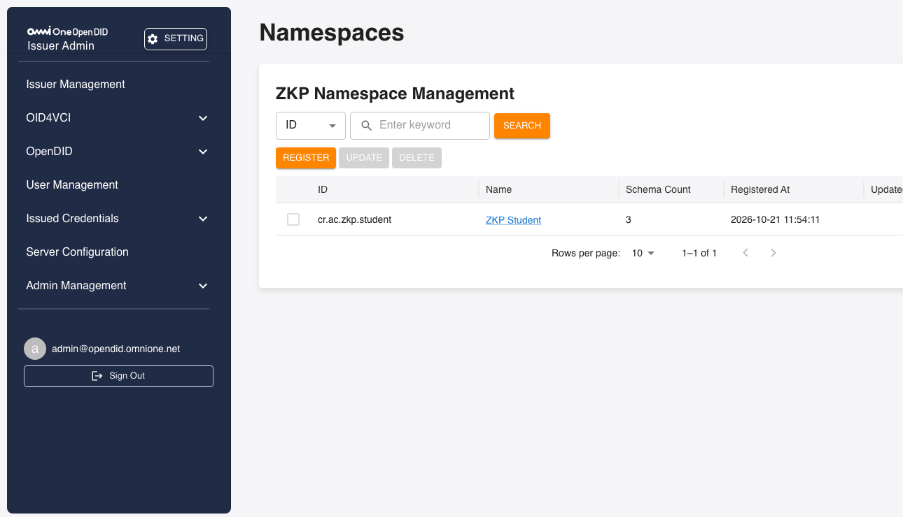

| 항목            | 설명                                     |
|-----------------|------------------------------------------|
| **ID**          | Namespace의 고유 ID                      |
| **Name**        | Namespace 이름 (클릭 시 상세 화면 이동)  |
| **Schema Count**| 해당 Namespace를 참조 중인 Schema 수     |
| **Registered At**| 최초 등록 일시                          |
| **Updated At**   | 마지막 수정 일시                         |

- `REGISTER` 버튼: 새로운 Namespace 등록 화면으로 이동  
- 항목 선택 시 `UPDATE`, `DELETE` 버튼 활성화

#### ▸ ZKP Namespace 등록

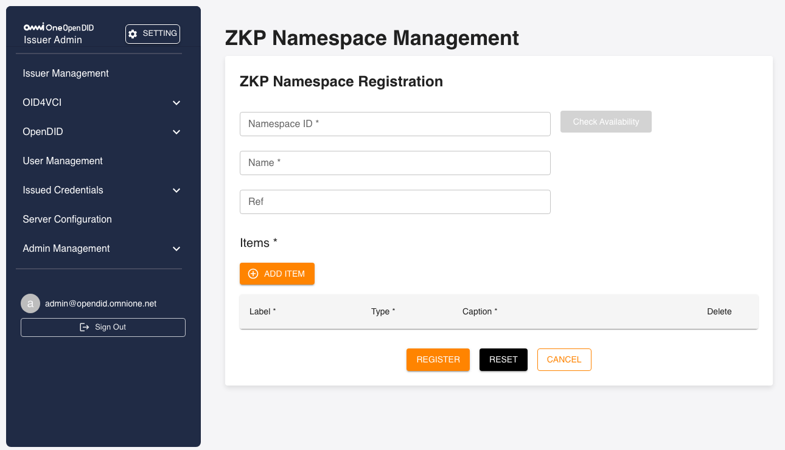

| 항목             | 설명                                                              |
|------------------|-------------------------------------------------------------------|
| **Namespace ID** | 고유 식별자 (`Check Availability` 버튼으로 중복 확인)              |
| **Name**         | Namespace 이름                                                    |
| **Ref**          | 관련 설명이나 참조 링크                                           |
| **Items**        | 포함할 Claim 항목 목록 (Label, Type, Caption 필수, Type은 `String` 또는 `Number`) |

- `ADD ITEM` 버튼으로 항목을 추가할 수 있습니다.  
- 등록 완료 시 `REGISTER` 버튼 클릭  
- `RESET` 버튼은 폼 초기화, `CANCEL`은 등록 취소

#### ▸ ZKP Namespace 상세 정보

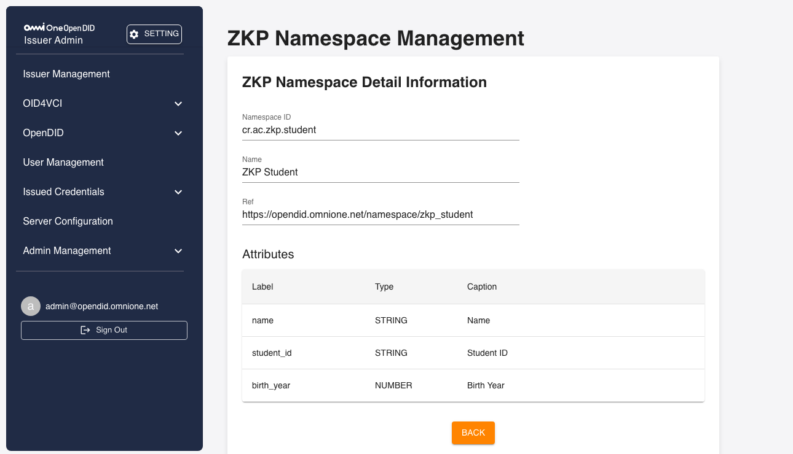

- 등록된 Namespace 정보를 열람할 수 있습니다.
- 하단 Attributes 테이블에서 Claim 항목 목록을 확인할 수 있습니다.

#### ▸ ZKP Namespace 수정

> 네임스페이스를 사용하는 Credential Schema가 없을 경우 수정할 수 있습니다.
> Credential Schema에서 해당 네임스페이스를 참고하고 있을 경우 수정할 수 없습니다.

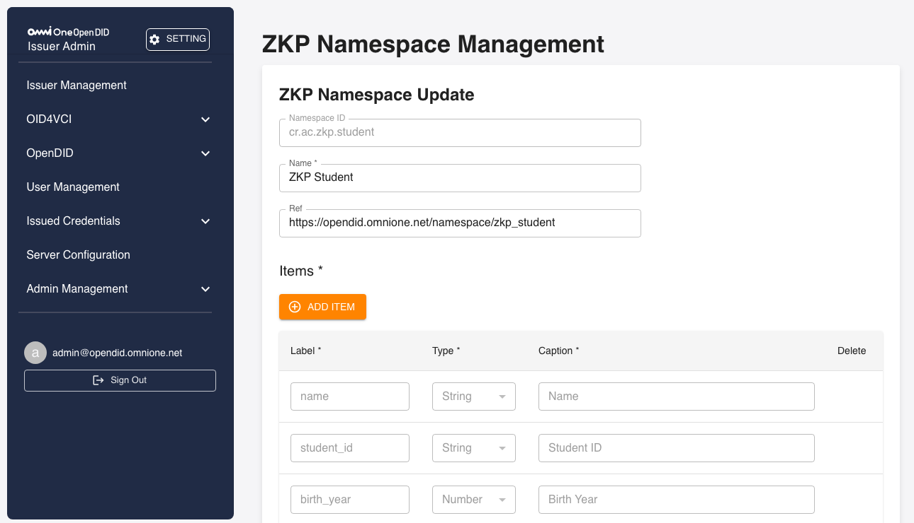

- Claim 항목은 추가/삭제가 가능하며, 내용 수정도 가능합니다.
- 수정 후 `UPDATE` 버튼으로 저장

---

### 3.5.2. Credential Schemas

Credential Schemas는 ZKP 기반 Credential 발급 시 사용될 **ZKP Credential Schema**를 정의하고 관리하는 메뉴입니다.  

ZKP Credential Schema는 **ZKP Namespace에 정의된 Claim 항목들을 기반으로 구성**되며, VC에 어떤 정보를 포함할 것인지 결정합니다.

이 Schema는 일반 VC에서 사용하는 VC Schema와는 별도의 구조이며, **ZKP 방식에 최적화된 Claim 정보만을 포함**합니다.  
Schema에 포함된 각 Claim은 이후 ZKP 증명의 입력 값으로 활용되며, **ZKP Definition과 1:1로 연결**됩니다.

#### 일반 VC Schema와 ZKP Credential Schema의 차이점

| 항목 | VC Schema (일반 VC) | ZKP Credential Schema |
|------|----------------------|------------------------|
| 참조 대상 | 일반 VC Namespace | ZKP Namespace |
| 사용 목적 | 일반 VC 발급용 Claim 구조 | ZKP 증명용 VC 구조 |
| 활용 방식 | Issue Profile에서 참조 | Credential Definition으로 연결 |
| 주요 특징 | 다양한 Claim 포함 가능 | **ZKP 증명 가능한 Claim으로만 구성** |

Credential Schema는 이후 **Credential Definition 등록 시 필수로 선택**되며,  
Definition ID를 통해 최종적으로 Issue Profile에 연결됩니다.

Credential Schema를 구성할 때는 **해당 Claim 항목들이 ZKP 증명에 적합한 구조인지**를 검토한 뒤,  
ZKP Namespace를 기반으로 Claim들을 조합하여 구성해야 합니다.

> 본 메뉴는 **Issuer 등록 및 ZKP Namespace 등록 후 사용 가능합니다.**  
> Credential Schema는 ZKP 발급 구조를 정의하며, 이후 ZKP Definition 생성 및 VC 발급의 핵심 기준이 됩니다.

#### ▸ Credential Schema 목록

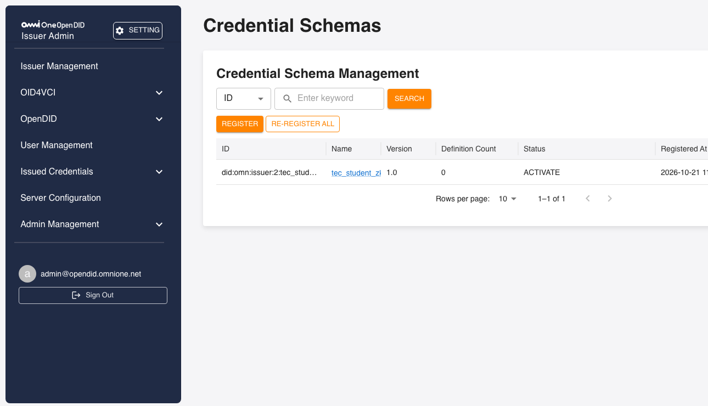

| 항목 | 설명 |
| ---- | ---- |
| **ID** | Ledger에 등록된 Credential Schema ID입니다. (예: `did:omn:issuer:2:tec_student_zkp:1.0`) |
| **Name** | 스키마 이름입니다. 클릭 시 상세 화면으로 이동합니다. |
| **Version** | 스키마 버전입니다. |
| **Definition Count** | 해당 스키마를 참조하는 Credential Definition 수입니다. |
| **Status** | Ledger 등록 상태입니다. |
| **Registered At / Updated At** | 등록 및 수정 일시입니다. |

- 등록된 스키마가 없다면 “No rows”로 표시됩니다.
- `REGISTER` 버튼 클릭 시 새 스키마 등록 가능
- `RE-REGISTER ALL` 버튼은 등록된 모든 Credential Schema를 Ledger에 다시 등록합니다.

#### ▸ Credential Schema 등록

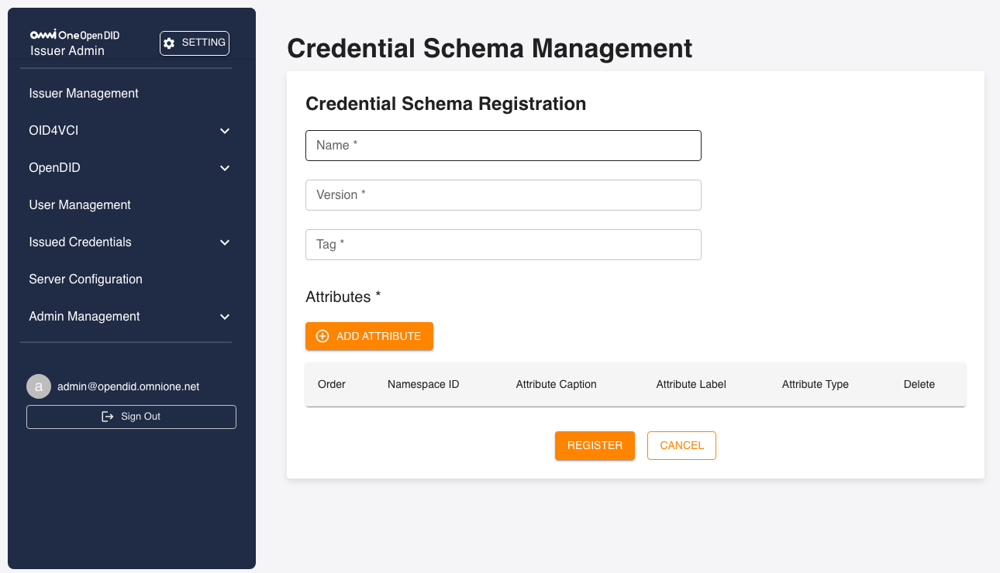

| 항목         | 설명                                                           |
|--------------|----------------------------------------------------------------|
| **Name**     | 스키마 이름                                                    |
| **Version**  | 스키마 버전 (예: 1.0)                                           |
| **Tag**      | 스키마 식별용 태그                                              |
| **Attributes**| 구성 항목 목록 (Namespace ID, Caption, Label, Type으로 구성됨) |

- `ADD ATTRIBUTE` 버튼으로 구성 항목 추가  
- 항목은 ZKP Namespace를 기반으로 선택하며, 드래그하여 순서를 변경할 수 있습니다.

#### ▸ Credential Schema 상세 정보

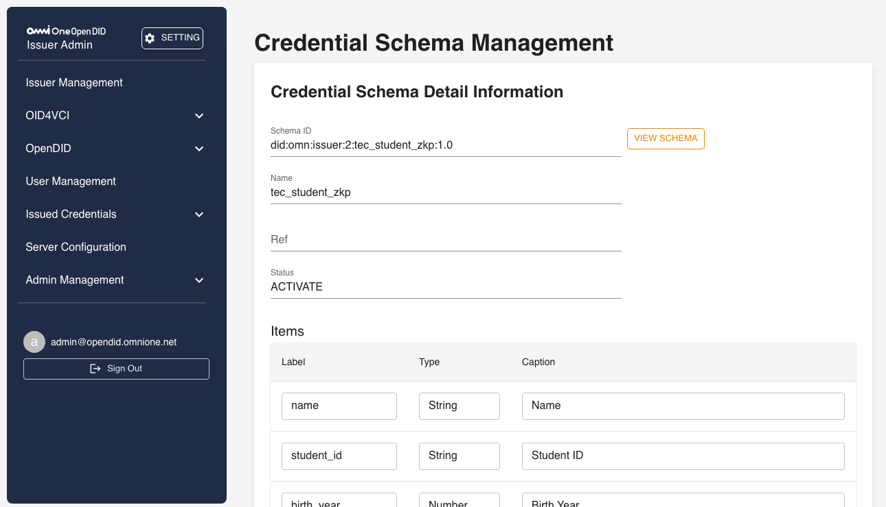

- 등록된 스키마의 상세 정보를 확인할 수 있습니다.
- 각 항목(Label, Type, Caption)이 테이블 형태로 표시됩니다.
- `VIEW SCHEMA` 버튼으로 Ledger에 등록된 Schema 원문을 확인할 수 있습니다.

---

### 3.5.3. Credential Definitions

Credential Definitions는 ZKP 기반 Verifiable Credential(VC) 발급을 위한  
**Credential Definition**을 정의하고 관리하는 메뉴입니다.

Credential Definition은 특정 ZKP Credential Schema를 기반으로,  
어떤 방식으로 ZKP Credential을 생성하고 증명할지를 지정하는 **발급 정책의 정의서**입니다.  
이 Definition은 **VC 발급 시 ZKP Credential을 함께 생성하기 위한 기준 정보**로 사용됩니다.

#### VC 발급 시 ZKP Credential 생성 및 사용자 전달

ZKP 발급을 위해 구성된 **Issue Profile**이 이 Definition을 참조하고,  
해당 프로파일을 기반으로 사용자가 VC를 발급받을 경우, 시스템은 다음 두 가지 Credential을 생성합니다:

1. 일반 Verifiable Credential (JSON-LD 또는 JWT 형태)  
2. ZKP Credential (정형화된 ZKP 구조, 예: CL 증명용 데이터)

이때 생성된 ZKP Credential은 내부적으로 Definition에서 정의한 구조 및 정책을 따르며,  
**발급 직후 사용자에게 함께 전달됩니다.**  
사용자는 이를 향후 검증자에게 제출하여 **Zero-Knowledge Proof를 통한 증명**을 수행할 수 있습니다.

Definition 자체는 블록체인에 발행되 조회할 수 있으며, 
**시스템 내부에서 증명 가능한 ZKP Credential 생성을 위한 참조 정보**와 검증을 위한 용도로 사용됩니다.

#### Credential Definition 구성 요소

- **Credential Schema**: 정의가 참조하는 ZKP Credential Schema
- **Definition Alias**: Definition을 구분하기 위한 별칭
- **Definition Version**: Definition의 버전 정보
- **Definition Type**: 증명 방식 (예: `CL`)
- **Definition Tag**: 관리 및 검색을 위한 태그

> 본 메뉴는 **Issuer 등록 및 ZKP Credential Schema 등록 후 사용 가능합니다.**  
> Credential Definition은 VC 발급 시, **ZKP Credential을 함께 생성하여 사용자에게 전달하기 위한 참조 정보**입니다. 

#### ▸ Credential Definition 목록

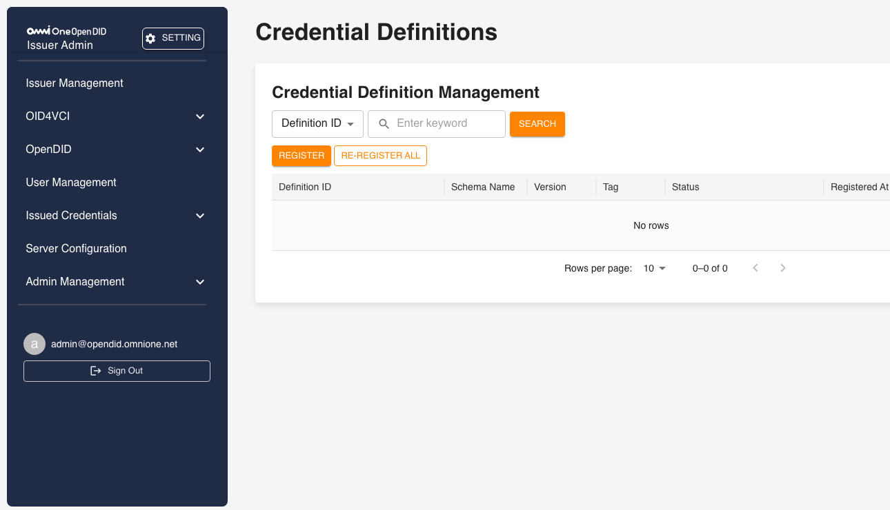

- 등록된 Definition이 없는 경우 “No rows”로 표시됩니다.
- 목록에는 Definition ID, Schema Name, Version, Tag, Status, 등록/수정 일시가 표시됩니다.
- `REGISTER` 버튼 클릭 시 새 Definition 등록 가능
- `RE-REGISTER ALL` 버튼은 등록된 모든 Credential Definition을 Ledger에 다시 등록합니다.

#### ▸ Credential Definition 등록

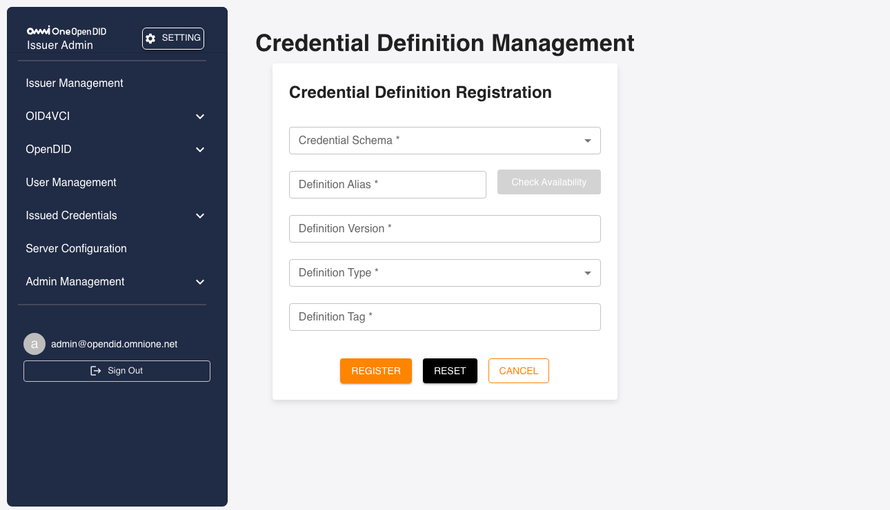

| 항목               | 설명                                               |
|--------------------|----------------------------------------------------|
| **Credential Schema** | 등록된 스키마 선택 (드롭다운 방식)               |
| **Definition Alias** | 정의의 식별용 별칭                                 |
| **Definition Version** | 정의 버전                                        |
| **Definition Type** | 사용 방식 선택 (예: CL)                            |
| **Definition Tag** | 태그 정보                                           |

- 등록 완료 후 `REGISTER` 버튼 클릭
- `Check Availability`로 Definition Alias 중복 확인 가능

#### ▸ Credential Definition 상세 정보

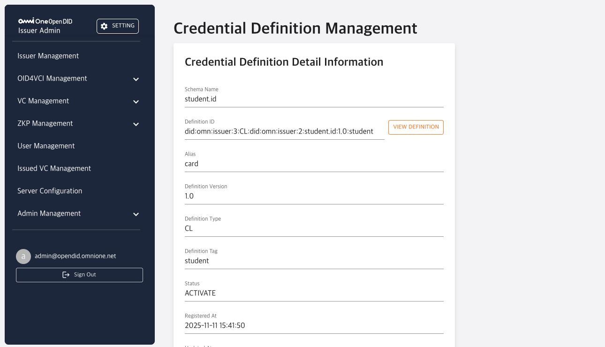

- Definition ID, Alias, 연결된 Schema, 상태 등의 정보 확인 가능
- 정의된 내용은 삭제 불가하며, 열람만 가능

---

## 3.6. User Management

User Management는 Verifiable Credential(VC) 발급 시 참조되는 **사용자 정보를 확인**할 수 있는 메뉴입니다.  
사용자 정보는 VC 발급에 필요한 **DID, PII, VC 데이터(Claim)** 등을 포함하며,  
해당 정보는 발급 시점에 시스템에 자동 등록됩니다.

등록된 사용자는 VC 발급 대상자로 간주되며, 시스템은 이 정보를 바탕으로 **사용자에게 맞춤화된 VC를 생성**합니다.  
사용자 정보는 VC Schema와 연결되어 있으며, VC 생성 시 필드 값 추출 및 검증에 사용됩니다.

> **참고:** Issue Profile의 User Query Method가 `TEST`인 경우 사용자 정보를 사전에 등록하지 않아도 발급할 수 있습니다.

#### ▸ 사용자 목록

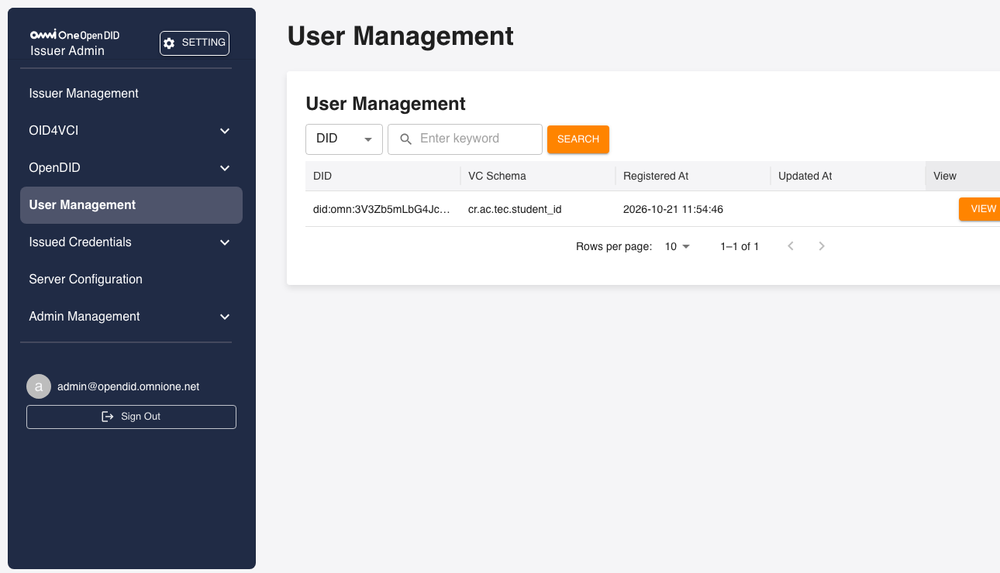

| 항목 | 설명 |
|------|------|
| **DID** | 사용자의 DID |
| **VC Schema** | 사용자가 연결된 VC Schema의 ID |
| **Registered At** | 최초 등록 일시 |
| **Updated At** | 마지막 수정 일시 |
| **View** | 클릭 시 사용자 상세 정보 화면으로 이동합니다. |

#### ▸ 사용자 상세 정보

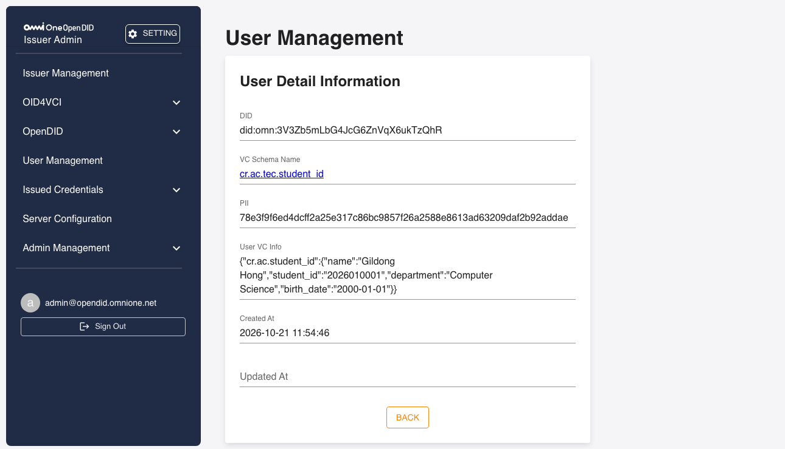

| 항목 | 설명 |
|------|------|
| **DID** | 사용자의 고유 식별자 (Decentralized Identifier) |
| **VC Schema Name** | 해당 사용자의 VC가 참조하는 VC Schema ID |
| **PII** | 사용자의 개인 식별 정보(Personal Identifiable Info) 해시값 |
| **User VC Info** | 사용자에게 발급할 VC 데이터 (JSON 형태) |
| **Created At** | 사용자 등록 일시 |
| **Updated At** | 마지막 수정 일시 |

---

## 3.7. Issued Credentials

Issued Credentials 메뉴는 발급된 Credential을 발급 프로토콜별로 조회하고 상태를 관리합니다.

- **OID4VCI Credentials**: OID4VCI로 발급된 SD-JWT VC, mdoc의 발급 이력과 Status List 상태
- **OpenDID Credentials**: OpenDID 프로토콜로 발급된 VC

### 3.7.1. OID4VCI Credentials

OID4VCI로 발급된 Credential의 발급 이력을 검색하고, 상세 정보를 조회하거나 Status List 상태를 변경하는 화면입니다.

#### ▸ OID4VCI Credential 목록

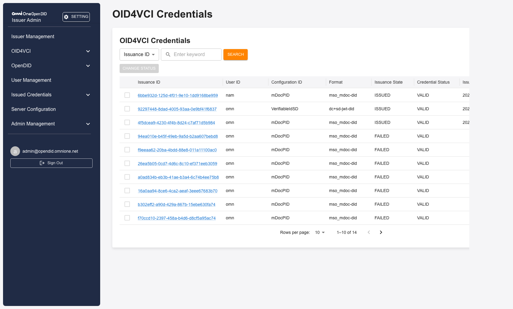

| 항목 | 설명 |
| ---- | ---- |
| **Issuance ID** | 발급 건의 고유 식별자입니다. 클릭 시 상세 화면으로 이동합니다. |
| **User ID** | Credential을 발급받은 사용자 ID입니다. |
| **Configuration ID** | 발급에 사용된 Credential Configuration ID입니다. |
| **Format** | 발급된 Credential 형식입니다. (예: `dc+sd-jwt-did`, `mso_mdoc-did`) |
| **Issuance State** | 발급 처리 상태입니다. (`ALLOCATED`, `ISSUED`, `FAILED`) |
| **Credential Status** | Status List에 기록된 Credential 상태입니다. (`VALID`, `SUSPENDED`, `INVALID`, `RESERVED`) |
| **Issued At** | 발급 일시입니다. |

- 검색 조건으로 Issuance ID, User ID, Configuration ID, Format, Issuance State, Credential Status를 사용할 수 있으며, Format·Issuance State·Credential Status는 선택형으로 검색합니다.
- 목록은 서버 페이지네이션으로 조회합니다.

#### ▸ Credential Status 변경

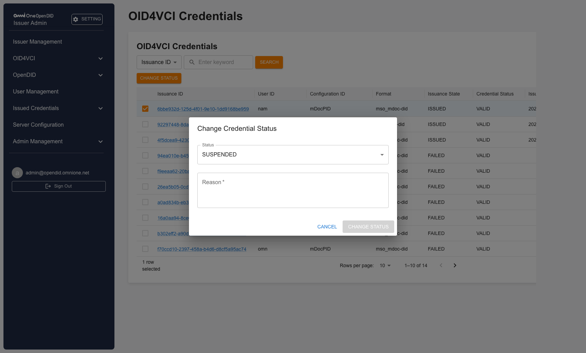

목록에서 항목을 선택한 뒤 `CHANGE STATUS` 버튼을 클릭하면 **Change Credential Status** 다이얼로그가 표시됩니다.

| 현재 상태 | 변경 가능 상태 |
| --------- | -------------- |
| `VALID` | `SUSPENDED`, `INVALID` |
| `SUSPENDED` | `VALID`, `INVALID` |
| `INVALID` | (변경 불가) |

| 항목 | 설명 |
| ---- | ---- |
| **Status** | 변경할 상태를 선택합니다. |
| **Reason** | 변경 사유를 입력합니다. 필수 항목이며 최대 512자, 공백만 입력할 수 없습니다. |

> **참고**  
> - Issuance State가 `ISSUED`인 Credential만 상태를 변경할 수 있습니다.  
> - 상태를 변경하면 Status List의 해당 Index 값과 Status List 버전이 갱신되고, 변경 이력(사유 포함)이 저장됩니다.  
> - Wallet이 직접 요청하는 폐기는 Issuer Metadata의 Credential Revocation Endpoint로 처리되며, 이 경우 상태가 `INVALID`로 변경됩니다.

#### ▸ OID4VCI Credential 상세 정보

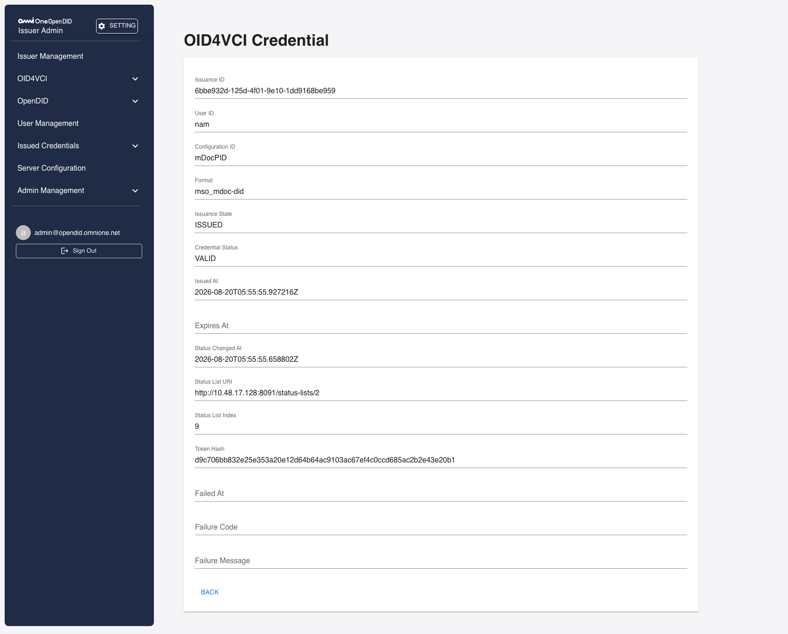

| 항목 | 설명 |
| ---- | ---- |
| **Issuance ID / User ID** | 발급 건 식별자와 사용자 ID입니다. |
| **Configuration ID / Format** | 발급에 사용된 Configuration과 Credential 형식입니다. |
| **Issuance State / Credential Status** | 발급 처리 상태와 Status List 상태입니다. |
| **Issued At / Expires At** | 발급 일시와 만료 일시입니다. |
| **Status Changed At** | 마지막으로 상태가 변경된 일시입니다. |
| **Status List URI / Status List Index** | Credential이 참조하는 Status List의 URI와 Index입니다. |
| **Token Hash** | 발급된 Credential 토큰의 해시값입니다. |
| **Failed At / Failure Code / Failure Message** | 발급이 실패한 경우 실패 일시와 원인입니다. |

- `BACK` 버튼으로 목록으로 돌아갑니다.

---

### 3.7.2. OpenDID Credentials

OpenDID 프로토콜로 발급된 Verifiable Credential(VC)의 목록을 조회하고 상태를 관리할 수 있는 기능입니다.  
해당 화면에서는 VC 상태를 변경하는 **UPDATE 기능**이 제공됩니다.

#### ▸ OpenDID Credential 목록

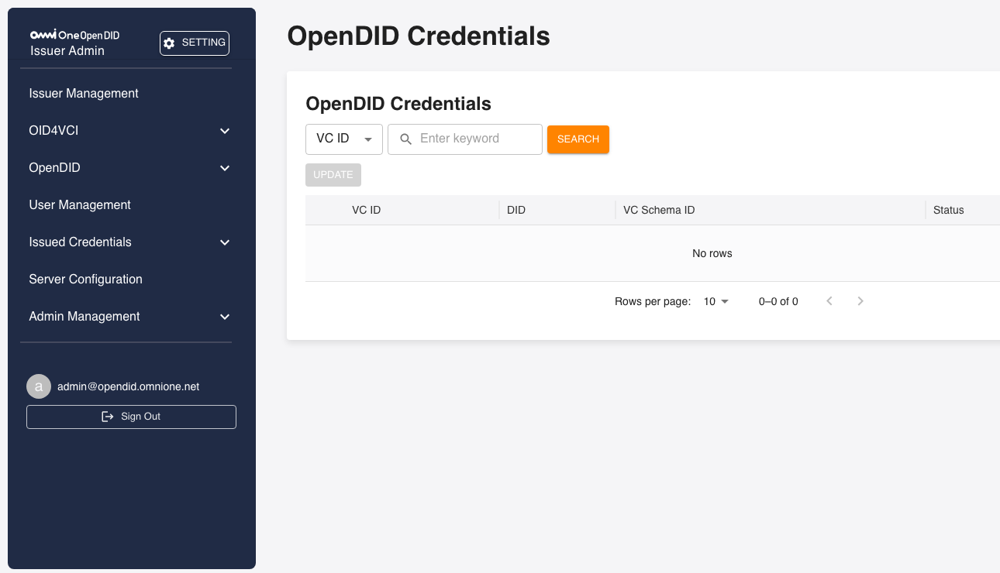

| 항목 | 설명 |
|------|------|
| **VC ID** | VC 고유 식별자 (상세로 이동) |
| **DID** | 발급 대상 사용자 DID |
| **VC Schema ID** | 발급된 VC의 Schema ID |
| **Status** | VC 상태 |
| **Registered At** | 발급 일시 |

- 목록에서 항목을 선택하면 상단의 `UPDATE` 버튼이 활성화됩니다.

#### ▸ OpenDID Credential Status 변경

선택한 VC의 상태를 변경할 수 있습니다. 상태 변경은 아래 조건에 따라 가능합니다.

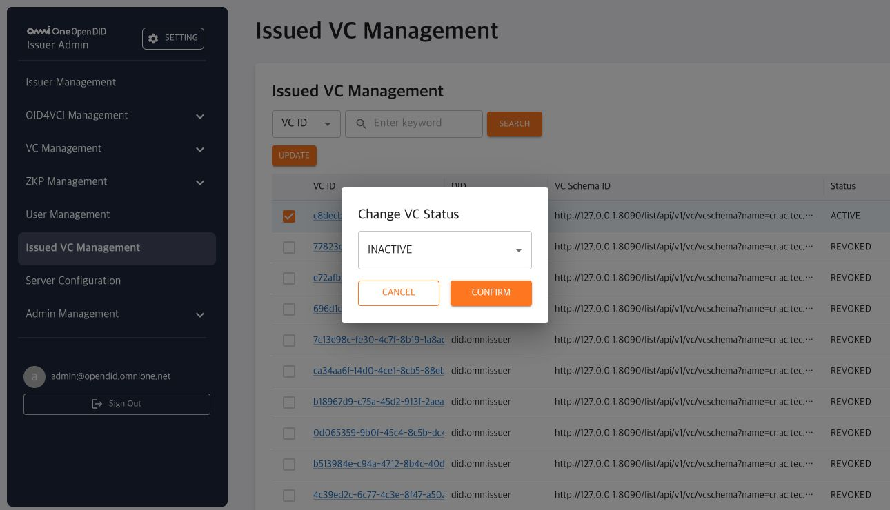

| 현재 상태 | 변경 가능 상태 |
|-----------|----------------|
| `ACTIVE` | `INACTIVE`, `REVOKED` |
| `INACTIVE` | `ACTIVE`, `REVOKED` |
| `REVOKED` | (변경 불가) |

> **참고**  
> `REVOKED` 상태는 불변이며, 복구 또는 상태 변경이 불가능합니다.  
> 상태 변경은 사용자 VC의 유효성 관리와 추적을 위한 기능입니다.

1. VC 목록에서 항목 선택 후 `UPDATE` 버튼 클릭  
2. **Change VC Status** 다이얼로그에서 상태 선택  
3. 확인 후 저장하면 VC 상태가 변경됩니다

#### ▸ OpenDID Credential 상세 정보

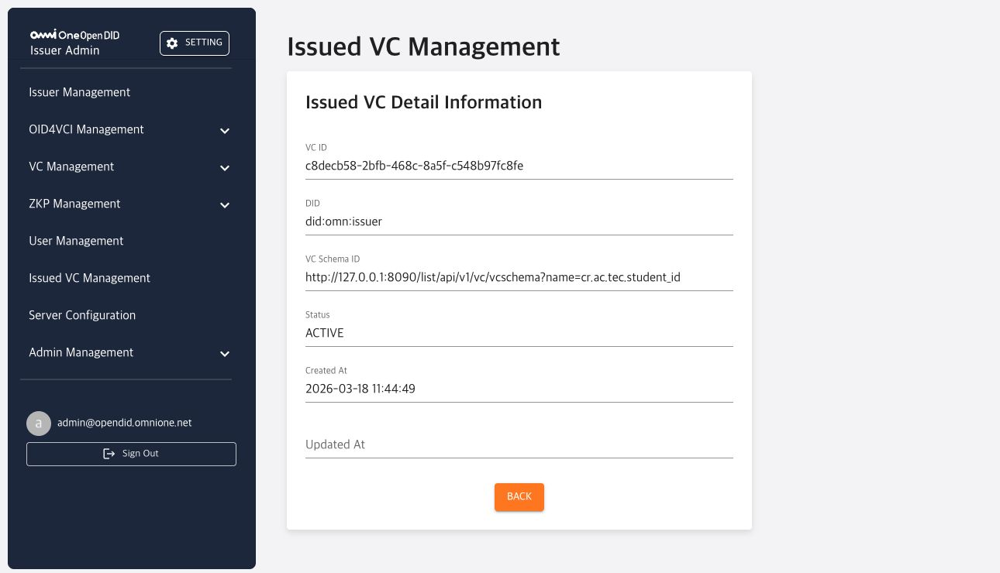

| 항목 | 설명 |
|------|------|
| **VC ID** | 고유 식별자 |
| **DID** | 사용자 DID |
| **VC Schema** | 발급한 VC 스키마 |
| **Status** | VC 상태 (`ACTIVE`, `REVOKE` 등) |
| **Created At / Updated At** | 생성 및 수정 시각 |

---

## 3.8. Server Configuration

`/server-configuration` 화면은 Issuer 서버가 외부 서버와 연동할 때 사용하는 Runtime 설정을 관리합니다. 설정값은 `/issuer/admin/v1/server-configs` API로 조회·저장되며, 등록되지 않은 Key는 저장할 수 없습니다.

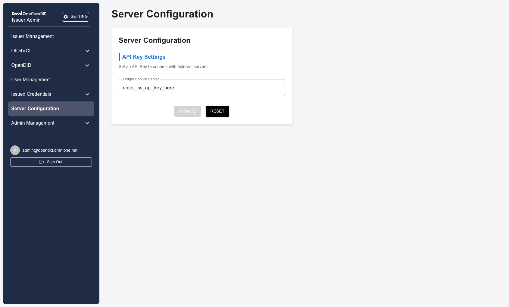

| 항목 | 설명 |
| ---- | ---- |
| **API Key Settings - Ledger Service Server** | Ledger Service Server(LSS) 연동 시 `X-API-Key` 헤더로 전송할 API Key입니다. (`API_KEY_LSS`) |
| **UPDATE 버튼** | 입력한 값을 저장합니다. |
| **RESET 버튼** | 입력값을 저장된 값으로 되돌립니다. |

> **참고:** `lss` 프로파일로 구동한 경우 VC Schema, Credential Schema/Definition 등록 시 LSS를 사용하므로 API Key가 올바르게 설정되어 있어야 합니다.

---

## 3.9. Admin Management

`Admin Management` 메뉴는 관리자 계정과 비밀번호 정책을 관리하는 상위 메뉴로, 다음 두 개의 하위 메뉴로 구성됩니다.

- Admin Management
- Password Policy Settings

### 3.9.1. Admin Management

`Admin Management` 화면은 Issuer Admin Console에 접근할 수 있는 관리자 계정을 관리하는 기능입니다.  

Issuer 서버를 설치하면 기본적으로 `admin@opendid.omnione.net` 계정이 ROOT 권한으로 자동 생성됩니다.  
이 계정은 시스템 내 유일한 ROOT 계정이며, 삭제할 수 없습니다. 최초 로그인 시 ID와 비밀번호를 변경해야 합니다.

관리자 계정은 **ROOT**와 **Normal Admin** 두 가지 권한 유형으로 구분됩니다.  
ROOT 계정은 `Admin Management` 메뉴에서 모든 기능을 수행할 수 있으며, Normal Admin은 일반적인 조회 기능만 가능합니다.

---
> **참고:** 현재는 ROOT 계정과 Normal Admin 계정 간의 권한 차이는  
> `Admin Management` 메뉴에서 표시되는 버튼의 차이(Root만 REGISTER / DELETE / CHANGE PASSWORD 가능) 외에는 없습니다.  
> 그 외 시스템의 다른 메뉴에 대한 접근 권한이나 기능 제한은 아직 적용되어 있지 않습니다.
---

<br/>

#### ▸ Admin 목록 조회


`Admin Management` 메뉴에 진입하면 등록된 관리자 계정들의 목록이 테이블 형태로 표시됩니다.

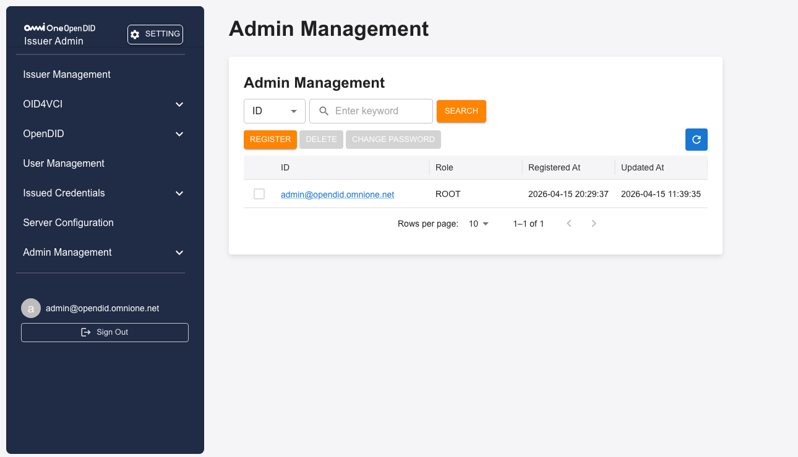


| 번호 | 항목                    | 설명                                                             |
| ---- | ----------------------- | ---------------------------------------------------------------- |
| 1    | **REGISTER 버튼**       | 새로운 관리자 계정을 등록할 수 있는 등록 페이지로 이동합니다.       |
| 2    | **DELETE 버튼**         | 선택한 관리자 계정을 삭제합니다. (ROOT 관리자만 가능)              |
| 3    | **CHANGE PASSWORD 버튼** | 선택한 관리자 계정의 비밀번호를 변경할 수 있습니다.                |
| 4    | **ID**                  | 등록된 관리자 계정의 이메일 ID입니다.                              |
| 5    | **Role**                | 해당 관리자 계정의 역할(Role)입니다. (예: ROOT, Normal Admin 등)   |
| 6    | **Registered At**       | 해당 계정이 최초 등록된 일시입니다.                               |
| 7    | **Updated At**          | 마지막으로 수정된 일시입니다.                                     |

<br/>

#### ▸ Admin 등록

`Admin Management` 화면에서 **REGISTER** 버튼을 클릭하면, 아래와 같은 등록 화면으로 이동합니다.

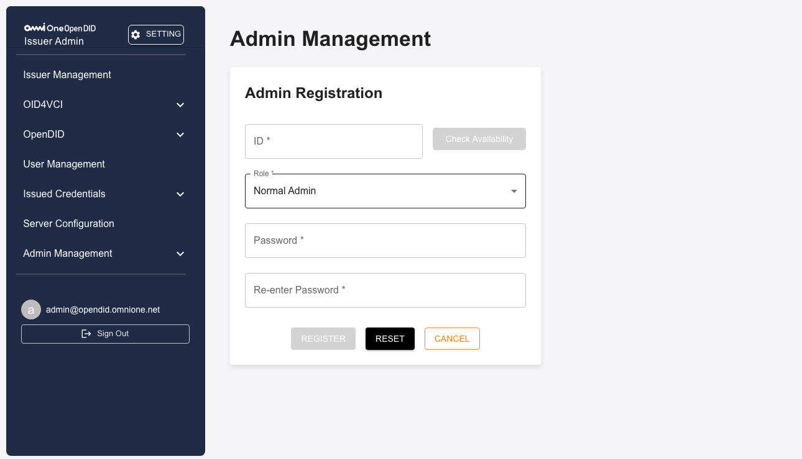

| 번호 | 항목                        | 설명                                                                |
| ---- | --------------------------- | ------------------------------------------------------------------- |
| 1    | **ID**                      | 등록할 관리자 계정의 ID입니다. 이메일 형식을 사용해야 합니다.         |
| 2    | **Check Availability 버튼** | 입력한 ID가 중복되지 않는지 확인합니다.                             |
| 3    | **Role**                    | 등록할 관리자 계정의 권한을 선택합니다. (예: Normal Admin)           |
| 4    | **Password**                | 로그인 시 사용할 비밀번호를 입력합니다.                              |
| 5    | **Re-enter Password**       | 비밀번호를 한 번 더 입력하여 일치 여부를 확인합니다.                |
| 6    | **REGISTER 버튼**           | 입력한 정보를 바탕으로 관리자 계정을 등록합니다.                    |
| 7    | **RESET 버튼**              | 모든 입력값을 초기화합니다.                                         |
| 8    | **CANCEL 버튼**             | 등록을 취소하고 이전 화면으로 돌아갑니다.                           |


### 3.9.2. Password Policy Settings

`Admin Management > Password Policy Settings`에서 관리자 비밀번호의 길이, 문자 구성 규칙 및 만료 기간을 설정합니다. 변경된 규칙은 이후 비밀번호 검증과 변경에 적용됩니다.

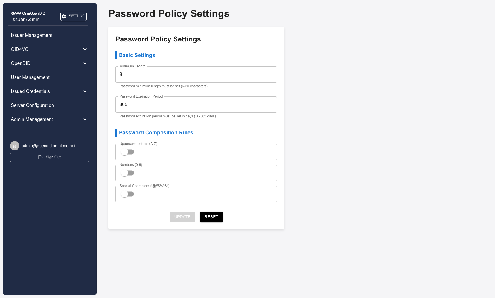

| 항목 | 설명 |
| ---- | ---- |
| **Minimum Length** | 비밀번호 최소 길이입니다. (6~20자) |
| **Password Expiration Period** | 비밀번호 만료 기간(일)입니다. (30~365일) 만료되면 다음 로그인 시 비밀번호 재설정이 요구됩니다. |
| **Uppercase Letters (A-Z)** | 대문자 포함 여부입니다. |
| **Numbers (0-9)** | 숫자 포함 여부입니다. |
| **Special Characters (!@#$%^&*)** | 특수문자 포함 여부입니다. |

[Open DID Installation Guide]: https://github.com/OmniOneID/did-release/blob/develop/unrelease-V2.0.0.0/OepnDID_Installation_Guide-V2.0.0.0_ko.md
